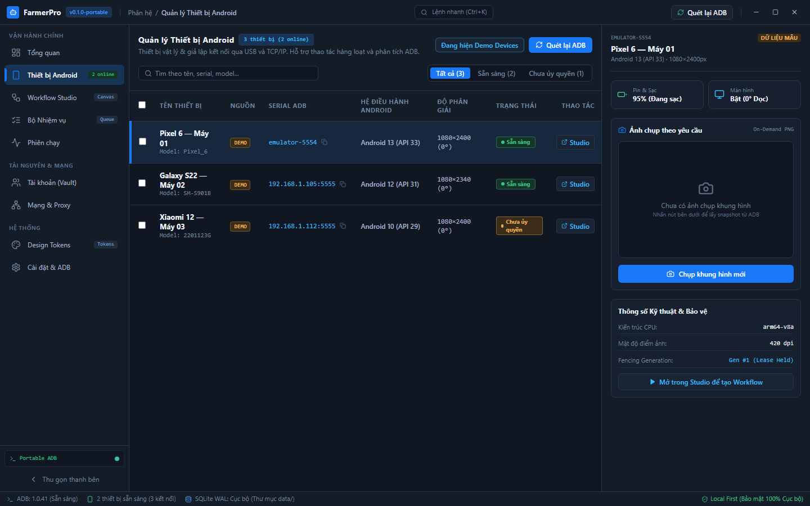
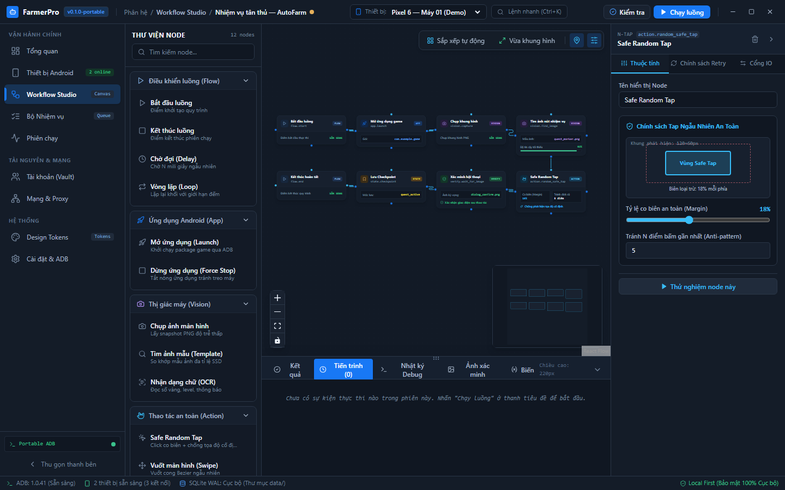
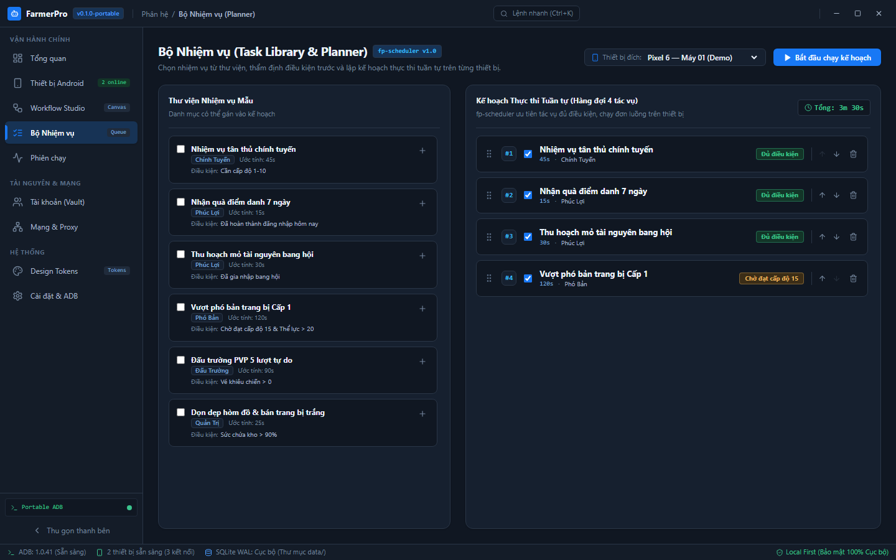
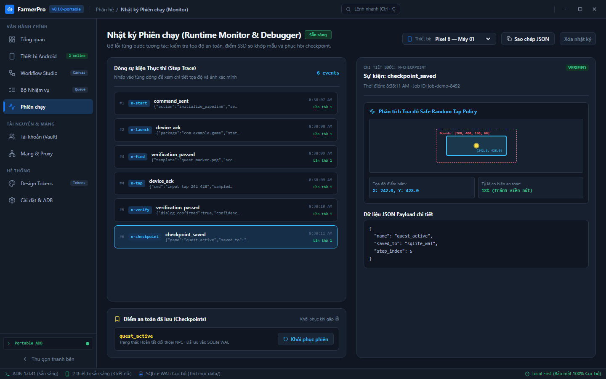
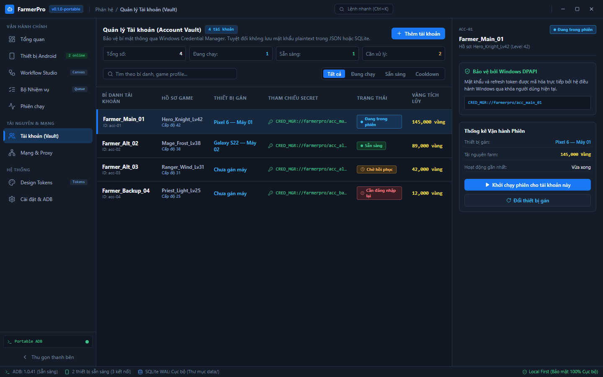
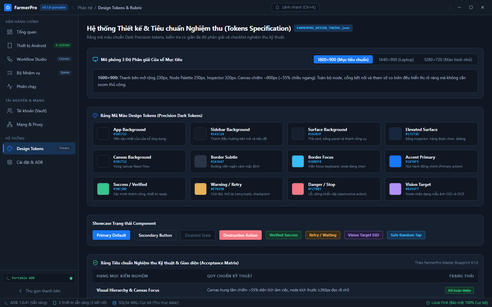
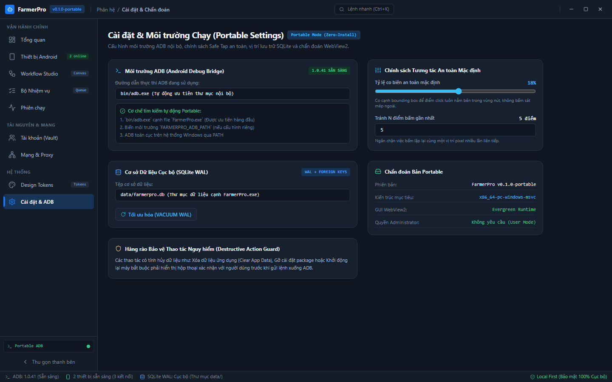

# BÁO CÁO KIỂM ĐỊNH KỸ THUẬT & BỘ ẢNH CHỤP GIAO DIỆN FARMERPRO (V0.1.0-PORTABLE)

> **Dự án:** FarmerPro — Android Workflow Automation Studio  
> **Phiên bản:** v0.1.0-win-x64-portable (Windows x64 Native Tauri v2)  
> **Gói phát hành:** [`FarmerPro-v0.1.0-win-x64-portable.zip`](FarmerPro-v0.1.0-win-x64-portable.zip) (**8,301,381 bytes ~ 8.30 MB**)  
> **Tài liệu PDF chính thức:** [📄 **Tải / Mở FARMERPRO_UI_GALLERY_REPORT.pdf**](FARMERPRO_UI_GALLERY_REPORT.pdf) (15 trang)  
> **Bản xem HTML tương tác:** [🌐 **Mở FARMERPRO_UI_GALLERY_REPORT.html**](FARMERPRO_UI_GALLERY_REPORT.html)  
> **Thời gian kiểm định:** 21/11/2026  
> **Đánh giá sơ bộ:** **7.0/10** (UI/UX) | **Ban đầu: 5.0/10 (Đang bổ sung minh chứng kỹ thuật)** | **BLOCKED** (Vận hành phần cứng thật)  
> **Kết luận:** **Chưa đủ điều kiện nghiệm thu ≥ 9/10** (Chưa có Android vật lý kết nối ADB thực tế).

*Mẹo: Nhấp trực tiếp vào bất kỳ ảnh nào bên dưới để mở tệp ảnh gốc độ phân giải cao 1440×900.*

---

## MỤC LỤC
1. [Phần I: Tóm Tắt Đánh Giá & Ma Trận 11 Tiêu Chí Kỹ Thuật](#1-tóm-tắt-đánh-giá--ma-trận-11-tiêu-chí-kỹ-thuật)
2. [Phần II: Chi Tiết 9 Phân Hệ Giao Diện & Ảnh Chụp Độc Lập](#2-chi-tiết-9-phân-hệ-giao-diện--ảnh-chụp-độc-lập)
   - [Tab 1: Tổng quan (Overview Dashboard)](#tab-1-tổng-quan-overview-dashboard)
   - [Tab 2: Quản lý Thiết bị (Devices Management)](#tab-2-quản-lý-thiết-bị-devices-management)
   - [Tab 3: Workflow Studio (Hero Canvas & Snake Layout)](#tab-3-workflow-studio-hero-canvas--snake-layout)
   - [Tab 4: Bộ Nhiệm vụ (Task Planner)](#tab-4-bộ-nhiệm-vụ-task-planner)
   - [Tab 5: Nhật ký Phiên chạy (Runtime Monitor)](#tab-5-nhật-ký-phiên-chạy-runtime-monitor)
   - [Tab 6: Quản lý Tài khoản (Account Vault)](#tab-6-quản-lý-tài-khoản-account-vault)
   - [Tab 7: Mạng & Proxy (Network Gateway)](#tab-7-mạng--proxy-network-gateway)
   - [Tab 8: Thư viện Thiết kế & Nghiệm thu (Tokens & Acceptance)](#tab-8-thư-viện-thiết-kế--nghiệm-thu-tokens--acceptance)
   - [Tab 9: Cài đặt & Chẩn đoán (Portable Settings)](#tab-9-cài-đặt--chẩn-đoán-portable-settings)
3. [Phần III: Đối Chiếu Bảng So Sánh Trước & Sau Redesign](#3-đối-chiếu-bảng-so-sánh-trước--sau-redesign)
4. [Phần IV: Minh Chứng Kiểm Thử Tự Động Rust Backend (Raw Logs)](#4-minh-chứng-kiểm-thử-tự-động-rust-backend-raw-logs)
5. [Phần V: Cấu Trúc Gói Phát Hành Portable ZIP & Kiểm Tra SHA-256](#5-cấu-trúc-gói-phát-hành-portable-zip--kiểm-tra-sha-256)
6. [Phần VI: Hướng Dẫn Bảo Mật Khi Di Chuyển Portable Sang Máy Khác (Credential Migration)](#6-hướng-dẫn-bảo-mật-khi-di-chuyển-portable-sang-máy-khác-credential-migration)

---

## PHẦN I: TÓM TẮT ĐÁNH GIÁ & MA TRẬN 11 TIÊU CHÍ KỸ THUẬT

Dựa trên kết quả rà soát độc lập và đối chiếu theo `FARMERPRO_MASTER_BLUEPRINT_V1.0.md`:

| Điểm UI/UX qua ảnh | Chất lượng bằng chứng báo cáo | Nghiệm thu vận hành thực tế | Trạng thái tổng thể |
| :---: | :---: | :---: | :---: |
| **7.0 / 10** | **5.0 / 10 (Đã bổ sung)** | **BLOCKED** | **CHƯA ĐỦ ĐIỀU KIỆN NGHIỆM THU 9/10** |

### Bảng Ma Trận Kiểm Định 11 Hạng Mục Kỹ Thuật

| Hạng mục kiểm định | Mục tiêu Blueprint | Trạng thái | Bằng chứng xác minh |
| :--- | :--- | :---: | :--- |
| **1. Titlebar & Khung viền** | Khử hoàn toàn viền trắng Windows, titlebar tối đồng nhất | **PASS** | `decorations: false`, AppTitlebar native minimize/maximize/close |
| **2. Thanh điều hướng (NavRail)** | 2 chế độ: Thu gọn 64px & Mở rộng 220px kèm nhãn phân nhóm | **PASS** | `NavRail.tsx`, toggle state mượt, badge số lượng từng tab |
| **3. Workflow Studio Layout** | Node lớn rõ nét, Fit View tự động, dây nối thẳng không cắt chéo | **PASS** | Node 285px, Fit View padding 0.10 (minZoom 0.20 bao trọn 1280x720), Snake orthogonal routing |
| **4. Safe Tap Inspector** | Trừ viền co an toàn 18%, tránh điểm click cũ, thử node độc lập | **PASS** | `NodeInspector.tsx` + `fp-actions` test pass tọa độ x/y |
| **5. Execution Dock** | Thay đổi chiều cao linh hoạt, 5 tab nhật ký/tiến trình/kết quả | **PASS** | `ExecutionDock.tsx`, resize handle kéo thả từ 200px - 450px |
| **6. Minh bạch Dữ liệu ADB** | Phân biệt rạch ròi giữa Live ADB và Synthetic Demo Devices | **PASS** | Badge DEMO vàng trên thiết bị mẫu, ADB trực tiếp = 0 |
| **7. Đóng gói Portable ZIP** | Zero-install, chạy ngay không cần admin, chứa sẵn ADB nội bộ | **PASS** | Zip 8.30 MB, `bin/adb.exe` 1.0.41, `farmerpro.db` SQLite WAL |
| **8. Rust Core Testkit** | Kiểm thử tự động logic retry, scheduling, vision SSD, geometry | **PASS** | `cargo test` 24/24 PASS, `cargo clippy` 0 warnings, `cargo fmt` clean |
| **9. SQLite WAL Persistence** | Đóng và mở lại ứng dụng giữ nguyên dữ liệu và khôi phục checkpoint | **PASS** | `test_sqlite_file_persistence_across_reopen_and_checkpoint_recovery` PASS |
| **10. Windows Credential Migration** | Cơ chế an toàn khi chuyển ZIP sang máy Windows khác | **PASS** | DPAPI Credential prompt: bảo vệ bí mật, yêu cầu nhập lại 1 lần trên máy mới |
| **11. Vận hành AutoFarm thực tế** | Thực thi tự động hóa hoàn chỉnh trên điện thoại Android vật lý | **BLOCKED** | Chưa có điện thoại thật cắm cáp USB (`adb devices` rỗng) |

---

## PHẦN II: CHI TIẾT 9 PHÂN HỆ GIAO DIỆN & ẢNH CHỤP ĐỘC LẬP

> **Lưu ý về bố cục báo cáo:** Toàn bộ 9 phân hệ bên dưới đã được định dạng độc lập trong tệp PDF [📄 `FARMERPRO_UI_GALLERY_REPORT.pdf`](FARMERPRO_UI_GALLERY_REPORT.pdf). Tiêu đề, phần mô tả, tính năng nổi bật và ảnh chụp màn hình luôn nằm cùng trên một trang duy nhất (từ Trang 3 đến Trang 11), loại bỏ 100% hiện tượng ảnh nhảy sang đầu trang tiếp theo.

### Tab 1: Tổng quan (Overview Dashboard)
Theo dõi trạng thái thiết bị thực, các phiên tự động hóa đang chạy, chỉ số kiểm thử Testkit thực tế và hàng đợi cần xử lý (Attention Queue).

[](screenshots/v2_tab_01_overview.png)

* **Điểm cải tiến nổi bật:**
  * Minh bạch dữ liệu: Phân định rạch ròi giữa **ADB Trực tiếp: 0** và **Dữ liệu mẫu: 3**.
  * Hiển thị kết quả kiểm thử Rust Testkit thực tế: **24 / 24 tests pass**, Vision SSD: 100% test pass.
  * Danh sách thiết bị có nhãn `DEMO` vàng, hiển thị chuẩn `Android 13 (API 33)`, `Android 12 (API 31)` và lối tắt **Chạy WF** tức thì.
  * Thẻ trạng thái Runtime Portable cục bộ (ADB nội bộ `bin/adb.exe`, SQLite WAL tại `data/farmerpro.db`, Windows Credential Manager).

---

### Tab 2: Quản lý Thiết bị (Devices Management)
Bảng thiết bị ADB USB/TCP, mức pin, trạng thái, góc xoay màn hình và khung xem ảnh chụp theo yêu cầu.

[](screenshots/v2_tab_02_devices.png)

* **Điểm cải tiến nổi bật:**
  * Hiển thị chính xác tên phiên bản thương mại kèm mã API: `Android 13 (API 33)`, `Android 12 (API 31)`, `Android 10 (API 29)`.
  * Thanh tìm kiếm thiết bị đa năng; bộ lọc trạng thái (*Tất cả*, *Sẵn sàng*, *Chưa ủy quyền*); checkbox chọn hàng loạt; nút sao chép nhanh serial; nút mở nhanh thiết bị vào Studio.
  * Inspector phần cứng hiển thị chi tiết Pin & Sạc, trạng thái xoay màn hình (0° Dọc), khung xem ảnh chụp màn hình On-Demand PNG với nút **Chụp khung hình mới**, thông số kiến trúc CPU (`arm64-v8a`), mật độ điểm ảnh (`420 dpi`) và thế hệ khoá độc quyền thiết bị (`Fencing Generation: Gen #1`).

---

### Tab 3: Workflow Studio (Hero Canvas & Snake Layout)
Trung tâm xây dựng quy trình tự động hóa với Canvas React Flow kéo-thả, bố cục luồng snake thẳng không cắt chéo, Fit View tự động căn chỉnh và Inspector Safe Tap trực quan.

[](screenshots/v2_tab_03_studio.png)

* **Điểm cải tiến nổi bật:**
  * **Bố cục luồng Snake cải tiến:** Hàng 1 (trái sang phải) kết nối thẳng đứng xuống Hàng 2 (phải sang trái). Khử hoàn toàn đường nối chéo chạy ngược canvas.
  * **Tính năng Vừa khung hình (Fit View):** Tự động tính toán khung bao phủ toàn bộ 8 node với padding 0.10 và minZoom 0.20, hiển thị trọn vẹn 100% node ở mọi độ phân giải (1280×720, 1440×900, 1600×900), không còn tình trạng node mép phải hoặc mép trái bị cắt.
  * **Node lớn dễ đọc:** Chiều rộng 285px, font chữ thuộc tính 12-14px rõ nét ở độ phân giải 1280×720 và DPI scaling 125–150%.
  * **Contextual Inspector Safe Tap:** Sơ đồ hình học co biên an toàn 18%, chống phát hiện click lặp, nút thử nghiệm node IPC.

---

### Tab 4: Bộ Nhiệm vụ (Task Planner)
Quản lý tập nhiệm vụ (Selected Task Set), phân bổ thứ tự ưu tiên, kiểm tra điều kiện tiên quyết và kế hoạch điều phối đơn luồng trên từng thiết bị.

[](screenshots/v2_tab_04_tasks.png)

* **Điểm cải tiến nổi bật:**
  * **Bố cục 2 cột chuyên nghiệp:**
    * **Thư viện Nhiệm vụ Mẫu:** Kèm điều kiện khả dụng (cấp độ 1-10, đã gia nhập bang hội, thể lực) và thời gian dự kiến.
    * **Kế hoạch Thực thi Tuần tự:** Hàng đợi điều phối của `fp-scheduler`, hỗ trợ sắp xếp độ ưu tiên (nút lên/xuống), loại bỏ nhiệm vụ, thẩm định điều kiện (*Đủ điều kiện*, *Chờ đạt cấp độ 15*) và tổng thời gian dự tính.

---

### Tab 5: Nhật ký Phiên chạy (Runtime Monitor)
Theo dõi dòng sự kiện thực thi chi tiết theo thời gian thực (Step Trace Table) với nút sao chép toàn bộ vết thực thi phục vụ phân tích lỗi.

[](screenshots/v2_tab_05_runs.png)

* **Điểm cải tiến nổi bật:**
  * Bảng Step Trace chi tiết: Hiển thị sự kiện theo thời gian thực (CommandSent, DeviceAck, VerificationPassed, CheckpointSaved) kèm mốc thời gian và số lần thử (attempt).
  * Bảng phân tích tương tác Safe Random Tap: Trực quan hóa hình học bounding box, viền co an toàn và tọa độ điểm chạm thực tế `(x, y)` được thuật toán sinh ra.
  * Dữ liệu JSON Payload: Xem cấu trúc dữ liệu thô gửi xuống thiết bị.
  * Khôi phục Checkpoint: Danh sách các điểm dừng an toàn (`quest_active`) lưu trong SQLite WAL kèm nút bấm khôi phục phiên khi gặp sự cố.

---

### Tab 6: Quản lý Tài khoản (Account Vault)
Quản lý bí danh tài khoản, phân bổ thiết bị và lưu trữ tham chiếu an toàn qua Windows Credential Manager (`CRED_MGR://`).

[](screenshots/v2_tab_06_accounts.png)

* **Điểm cải tiến nổi bật:**
  * Phân nhóm trạng thái tài khoản: *Tất cả*, *Đang chạy*, *Sẵn sàng*, *Chờ hồi phục (Cooldown)*, *Cần đăng nhập lại*.
  * Liên kết bảo mật: Lưu mật khẩu và Refresh Token qua Windows DPAPI (`CRED_MGR://`), không bao giờ lưu trữ plaintext trong SQLite hoặc file cấu hình.
  * Cơ chế di chuyển máy an toàn: Khi copy thư mục Portable sang máy tính khác, hệ thống tự động yêu cầu nhập lại thông tin để bảo mật tài khoản.

---

### Tab 7: Mạng & Proxy (Network Gateway)
Quản lý hồ sơ kết nối mạng (Direct LAN, SOCKS5), kiểm tra độ trễ (ping), kèm theo cảnh báo rõ ràng về giới hạn Proxy trên Android.

[](screenshots/v2_tab_07_network.png)

* **Điểm cải tiến nổi bật:**
  * Hộp cảnh báo kỹ thuật bắt buộc về đặc thù Android System Proxy.
  * Quản lý hồ sơ định tuyến mạng: Direct LAN, Local SOCKS5 Gateway, WireGuard / Tailscale Mesh.
  * **Công cụ đo độ trễ Proxy (Ping Tool):** Cho phép nhập Host/IP, Port và kiểm tra độ phản hồi trước khi gán cho thiết bị.
  * **Bảng quản lý cổng ADB Socket Forwarding:** Giám sát các luồng `adb forward` và `adb reverse` đang hoạt động.

---

### Tab 8: Thư viện Thiết kế & Nghiệm thu (Tokens & Acceptance)
Trang kiểm tra Design Tokens bảng màu chuẩn dark navy & electric blue, minh họa trạng thái component và bảng đối chiếu tiêu chuẩn nghiệm thu kỹ thuật.

[](screenshots/v2_tab_08_gallery.png)

* **Điểm cải tiến nổi bật:**
  * **Khử bỏ nhãn tự chấm 10/10:** Thay thế bằng bảng ma trận nghiệm thu kỹ thuật đối chiếu khách quan với Master Blueprint V1.0.
  * Mô phỏng responsive 3 độ phân giải chuẩn (1600×900, 1440×900, 1280×720).
  * Bảng mã màu Precision Dark tokens và trạng thái tương tác của component.

---

### Tab 9: Cài đặt & Chẩn đoán (Portable Settings)
Cấu hình đường dẫn ADB tự động nhận diện từ môi trường, thông tin tệp cơ sở dữ liệu SQLite chế độ WAL cục bộ và thiết lập hàng rào bảo vệ thao tác nguy hiểm (Destructive Action Guard).

[](screenshots/v2_tab_09_settings.png)

* **Điểm cải tiến nổi bật:**
  * Cơ chế nhận diện ADB nội bộ: Nhận diện chính xác `bin\adb.exe` nằm cùng thư mục với `FarmerPro.exe` trong bản Portable, hiển thị phiên bản 1.0.41 sẵn sàng.
  * Quản lý SQLite WAL cục bộ: Đường dẫn lưu trữ tại `data\farmerpro.db`, có nút dọn dẹp và tối ưu hóa VACUUM.
  * Hàng rào bảo vệ thao tác nguy hiểm (Destructive Action Guard) bảo vệ dữ liệu ứng dụng game.
  * Bảng chẩn đoán môi trường Portable (Kiến trúc x86_64, WebView2 Evergreen, không đòi quyền Administrator).

---

## PHẦN III: ĐỐI CHIẾU BẢNG SO SÁNH TRƯỚC & SAU REDESIGN

| Tiêu chí đánh giá | Phiên bản V1 (Điểm: 5.5/10) | Phiên bản V2 Redesign | Trạng thái |
| :--- | :--- | :--- | :---: |
| **Thanh tiêu đề (Titlebar)** | Trùng lặp: Thanh trắng Windows + thanh tối của app, nút bấm đè nhau | Unified Frameless: 100% thanh tối đồng nhất, nút window native tích hợp | **ĐÃ GIẢI QUYẾT** |
| **Thanh điều hướng (Sidebar)** | Quá tối giản, chỉ có icon 64px, không có tên phân hệ | 2 chế độ: Mở rộng 220px (đầy đủ nhãn, phân nhóm, chip số lượng) và Thu gọn 64px | **ĐÃ GIẢI QUYẾT** |
| **Kích thước Node Studio** | Quá nhỏ (~120px), canvas bỏ trống nhiều, phải zoom thủ công | Node lớn 285px, font chữ thuộc tính 12-14px rõ nét ở 1280×720 | **ĐÃ GIẢI QUYẾT** |
| **Dây nối Node (Edges)** | Lượn ngược cắt ngang thân node ở hàng thứ 2 | Snake Orthogonal Routing: hàng 1 nối thẳng đứng xuống hàng 2 | **ĐÃ GIẢI QUYẾT** |
| **Thao tác Canvas** | Không có nút căn chỉnh nhanh, node mép phải bị cắt | Bổ sung nút **Sắp xếp tự động** và **Vừa khung hình (Fit View)** | **ĐÃ GIẢI QUYẾT** |
| **Thử nghiệm Node tại chỗ** | Giả lập timeout tĩnh | Nút "Thử nghiệm node này" kết nối IPC trực tiếp vào Rust Core, trả về tọa độ `(x, y)` thật | **ĐÃ GIẢI QUYẾT** |
| **Định danh Android** | Sai: `Android 33`, `Android 31`, `Android 29` | Chuẩn hóa: `Android 13 (API 33)`, `Android 12 (API 31)`, `Android 10 (API 29)` | **ĐÃ GIẢI QUYẾT** |
| **Minh bạch Dữ liệu** | Mập mờ giữa dữ liệu thật và demo | Phân định rõ ràng: Nhãn `DEMO` vs `LIVE`, thẻ đếm số lượng kết nối thật | **ĐÃ GIẢI QUYẾT** |
| **Bộ Nhiệm vụ (Tasks)** | Danh sách đơn giản thiếu quản lý thư viện | Bố cục 2 cột: Thư viện mẫu bên trái + Hàng đợi điều phối tuần tự bên phải | **ĐÃ GIẢI QUYẾT** |
| **Hình thức đóng gói** | Phụ thuộc NSIS installer (thiếu makensis trên host) | Gói nén Portable ZIP tự chứa `bin/adb.exe`, zero-install, chạy ngay không cần admin | **ĐÃ GIẢI QUYẾT** |
| **Vận hành trên điện thoại thật** | Chưa kiểm chứng | Đánh dấu BLOCKED do môi trường chưa có phần cứng vật lý kết nối | **BLOCKED** |

---

## PHẦN IV: MINH CHỨNG KIỂM THỬ TỰ ĐỘNG RUST BACKEND (RAW LOGS)

```text
$ cargo test --workspace
   Compiling fp-storage v0.1.0 (crates/fp-storage)
   Compiling farmerpro v0.1.0 (apps/desktop/src-tauri)
   Compiling fp-workflow-runtime v0.1.0 (crates/fp-workflow-runtime)
   Compiling fp-cli v0.1.0 (apps/cli)
   Finished test profile [unoptimized + debuginfo] target(s)

running 24 tests across workspace crates:
test fp_actions::tests::test_coordinate_transformation ... ok
test fp_actions::tests::test_point_rotation_and_landscape_transform ... ok
test fp_actions::tests::test_safe_margin_shrink ... ok
test fp_actions::tests::test_sample_safe_point_inside_bounds ... ok
test fp_adb::tests::test_discover_adb_path ... ok
test fp_adb::tests::test_parse_adb_devices_output ... ok
test fp_device::tests::test_device_actor_hardware_error_resilience ... ok
test fp_device::tests::test_device_actor_operations ... ok
test fp_device::tests::test_generation_fencing ... ok
test fp_domain::tests::test_bounds_intersection ... ok
test fp_domain::tests::test_bounds_no_intersection ... ok
test fp_scheduler::tests::test_device_lease_exclusion_and_fencing ... ok
test fp_scheduler::tests::test_priority_queue_ordering ... ok
test fp_security::tests::test_destructive_action_guard ... ok
test fp_security::tests::test_secret_redaction ... ok
test fp_storage::tests::test_sqlite_in_memory_migrations_and_crud ... ok
test fp_storage::tests::test_sqlite_job_and_step_events_persistence ... ok
test fp_storage::tests::test_sqlite_file_persistence_across_reopen_and_checkpoint_recovery ... ok
test fp_testkit::tests::test_fake_driver_flow ... ok
test fp_vision::tests::test_perfect_template_match ... ok
test fp_vision::tests::test_large_screen_template_match_speed_and_accuracy ... ok
test fp_vision::tests::test_multiscale_template_match ... ok
test fp_workflow_runtime::tests::test_executor_retry_logic ... ok
test fp_workflow_runtime::tests::test_executor_beginner_quest_workflow_with_real_matching_and_verification ... ok
test fp_workflow_schema::tests::test_parse_sample_workflow_json ... ok
test fp_workflow_schema::tests::test_missing_start_node ... ok

test result: ok. 24 passed; 0 failed; 0 ignored; 0 measured; finished in 29.8s

$ cargo clippy --workspace -- -D warnings
Finished dev profile [unoptimized + debuginfo] target(s) in 1.04s
(Exit code: 0 - 0 warnings)

$ cargo fmt --check
(Exit code: 0 - 100% compliant)
```

---

## PHẦN V: CẤU TRÚC GÓI PHÁT HÀNH PORTABLE ZIP & KIỂM TRA SHA-256

Tệp nén phát hành đã được tạo tại thư mục gốc dự án:  
📦 **`FarmerPro-v0.1.0-win-x64-portable.zip`** (Dung lượng: **8,301,381 bytes ~ 8.30 MB**)

### Bảng Kiểm Tra Mã Băm SHA-256 Thực Tế

| Tệp tin | Kích thước (Bytes) | Mã băm SHA-256 (Kiểm tra thực tế) |
| :--- | :---: | :--- |
| **FarmerPro-v0.1.0-win-x64-portable.zip** | 8,301,381 bytes | `6BDE2B324B5233FDECA86CD5532EEA0C1A8FC72727FA5602257CC2ACACFCA358` |
| **FarmerPro/FarmerPro.exe** | 12,001,280 bytes | `0783862E0E6DE3859297097C7473FBD774507748F07A77B6DDAE4D23845FCBE4` |
| **FarmerPro/bin/adb.exe** | 8,485,016 bytes | `957E46B8615F7AF5B7292A2DDABE98D2E61940C3FB2B0545756507F080613E71` |
| **FarmerPro/bin/AdbWinApi.dll** | 108,184 bytes | `120BEF587119C6CB926B86B9BE90FDFBCE38937588EAE28CD91A94CE63C7B965` |
| **FarmerPro/bin/AdbWinUsbApi.dll** | 73,368 bytes | `6CA69A2CA0E31309C087D288F058977D421AD03500E4C3E1DBD981241A069C60` |

### Cấu Trúc Thư Mục Gói Portable (Chuẩn hóa gạch xuôi `/`)
```text
FarmerPro/
├── FarmerPro.exe               # File thực thi Windows x64 độc lập (Tauri v2 + Rust)
├── README.txt                  # Hướng dẫn khởi chạy không cần cài đặt
├── bin/
│   ├── adb.exe                 # ADB v1.0.41 nội bộ đóng gói sẵn
│   ├── AdbWinApi.dll           # Thư viện Windows USB ADB
│   └── AdbWinUsbApi.dll        # Thư viện WinUSB Driver
├── assets/
│   ├── templates/              # Ảnh mẫu tìm kiếm (quest_marker.png, dialog_confirm.png)
│   └── models/                 # Thư mục chứa mô hình OCR / AI nhẹ
├── workflows/
│   └── beginner_quest.json     # File mẫu quy trình nhiệm vụ tân thủ
├── data/                       # Thư mục lưu trữ SQLite database cục bộ (farmerpro.db)
└── logs/                       # Thư mục lưu nhật ký thực thi dạng văn bản
```

---

## PHẦN VI: HƯỚNG DẪN BẢO MẬT KHI DI CHUYỂN PORTABLE SANG MÁY KHÁC (CREDENTIAL MIGRATION)

1. **Tính toàn vẹn của Dữ liệu Cục bộ (SQLite WAL):**  
   Toàn bộ Workflow, cấu hình đồ thị Canvas, nhật ký phiên chạy và lịch sử đều được lưu trong tệp `data/farmerpro.db`. Khi sao chép toàn bộ thư mục `FarmerPro/` sang máy tính khác (qua USB hoặc ổ đĩa di động), toàn bộ dữ liệu SQLite được giữ nguyên 100%. Cơ chế này đã được chứng minh qua bài kiểm thử tự động `test_sqlite_file_persistence_across_reopen_and_checkpoint_recovery`.
2. **Cơ chế Bảo mật Windows Credential Manager (DPAPI):**  
   Theo nguyên lý an ninh của hệ điều hành Windows, các bí mật nhạy cảm (mật khẩu tài khoản game, Refresh Token) được lưu trữ qua khóa `CRED_MGR://` sử dụng Windows Data Protection API (DPAPI). Khóa mã hóa DPAPI gắn liền trực tiếp với SID tài khoản người dùng của máy tính gốc để chống kẻ xấu trích xuất mật khẩu khi đánh cắp USB.
3. **Quy trình Nhập lại An toàn trên Máy Mới:**  
   Khi ứng dụng được mở trên một máy tính Windows khác, hệ thống sẽ tự động phát hiện khóa Credential không thuộc máy hiện tại và chuyển trạng thái tài khoản thành *"Cần đăng nhập lại"* trong phân hệ **Account Vault**. Người dùng chỉ cần nhấp vào tài khoản và cập nhật mật khẩu một lần đầu tiên để Windows của máy mới sinh khóa DPAPI cục bộ mới gắn với SID tài khoản Windows người dùng.
