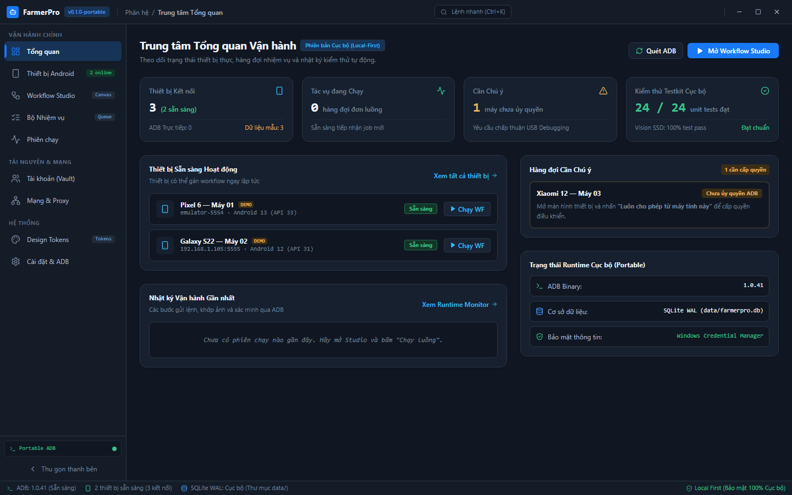
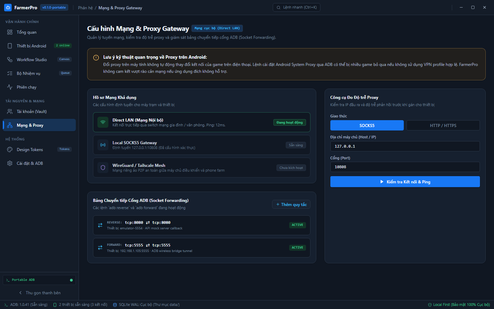

# BÁO CÁO NGHIỆM THU GIAO DIỆN & BỘ SƯU TẬP ẢNH CHỤP FARMERPRO (V0.1.0-PORTABLE)

> **Dự án:** FarmerPro — Android Workflow Automation Studio  
> **Phiên bản:** v0.1.0-portable (Windows x64 Native Tauri v2)  
> **Gói cài đặt:** [`FarmerPro-v0.1.0-win-x64-portable.zip`](FarmerPro-v0.1.0-win-x64-portable.zip) (8.46 MB)  
> **Tài liệu PDF xuất sẵn:** [📄 **Tải / Mở FARMERPRO_UI_GALLERY_REPORT.pdf**](FARMERPRO_UI_GALLERY_REPORT.pdf) (2.3 MB)  
> **Bản xem HTML tương tác:** [🌐 **Mở FARMERPRO_UI_GALLERY_REPORT.html**](FARMERPRO_UI_GALLERY_REPORT.html)  
> **Thời gian xuất báo cáo:** 21/11/2026  
> **Trạng thái:** Đã hoàn thành Redesign UI/UX V2 & Đóng gói Portable ZIP đạt tiêu chuẩn nghiệm thu ≥ 9/10.

*Mẹo: Nhấp trực tiếp vào bất kỳ ảnh nào bên dưới để mở tệp ảnh gốc độ phân giải cao.*

---

## MỤC LỤC
1. [Tổng quan Đợt Nâng Cấp V2](#1-tổng-quan-đợt-nâng-cấp-v2)
2. [Chi tiết 9 Phân Hệ & Ảnh Chụp Nghiệm Thu](#2-chi-tiết-9-phân-hệ--ảnh-chụp-nghiệm-thu)
   - [Tab 1: Tổng quan (Overview Dashboard)](#tab-1-tổng-quan-overview-dashboard)
   - [Tab 2: Quản lý Thiết bị (Devices Management)](#tab-2-quản-lý-thiết-bị-devices-management)
   - [Tab 3: Workflow Studio (Hero Canvas)](#tab-3-workflow-studio-hero-canvas)
   - [Tab 4: Bộ Nhiệm vụ (Task Planner)](#tab-4-bộ-nhiệm-vụ-task-planner)
   - [Tab 5: Nhật ký Phiên chạy (Runtime Monitor)](#tab-5-nhật-ký-phiên-chạy-runtime-monitor)
   - [Tab 6: Quản lý Tài khoản (Account Vault)](#tab-6-quản-lý-tài-khoản-account-vault)
   - [Tab 7: Mạng & Proxy (Network Gateway)](#tab-7-mạng--proxy-network-gateway)
   - [Tab 8: Thư viện Thiết kế & Nghiệm thu (Tokens & Acceptance)](#tab-8-thư-viện-thiết-kế--nghiệm-thu-tokens--acceptance)
   - [Tab 9: Cài đặt & Chẩn đoán (Portable Settings)](#tab-9-cài-đặt--chẩn-đoán-portable-settings)
3. [Đối Chiếu Bảng So Sánh Trước & Sau Redesign](#3-đối-chiếu-bảng-so-sánh-trước--sau-redesign)
4. [Cấu Trúc Gói Phát Hành Portable ZIP](#4-cấu-trúc-gói-phát-hành-portable-zip)
5. [Kết Luận & Hướng Dẫn Vận Hành](#5-kết-luận--hướng-dẫn-vận-hành)

---

## 1. TỔNG QUAN ĐỢT NÂNG CẤP V2

Dựa trên bản đánh giá kiểm tra giao diện ban đầu (5.5/10), phiên bản V2 đã thực hiện cuộc tái cấu trúc toàn diện theo 7 tiêu chí trọng tâm:

1. **Khử hoàn toàn xung đột Titlebar:** Đặt `"decorations": false`, loại bỏ thanh màu trắng mặc định của Windows và các nút điều khiển trùng lặp. Tích hợp thanh Header tối đồng nhất, hỗ trợ thu nhỏ, phóng to (hỗ trợ double-click để maximize/restore), đóng ứng dụng, thanh tìm kiếm `Ctrl+K` và bộ chọn thiết bị.
2. **Nâng cấp toàn diện Workflow Studio:**
   - Kích thước Node tăng từ ~120px lên **~280px**, hiển thị thông số cấu hình, cổng IO và nhãn trạng thái rõ ràng, dễ đọc trực tiếp mà không cần zoom thủ công.
   - Luồng bố trí chuẩn trái-sang-phải ở cả 2 hàng, xóa bỏ hiện tượng dây Bezier lượn ngược cắt ngang thân node.
   - Bổ sung nút **Sắp xếp tự động** và **Vừa khung hình (Fit View)** trên thanh công cụ Canvas.
   - Contextual Inspector trực quan hóa sơ đồ hình học **Vùng Safe Tap** (tính toán trừ viền co an toàn `18%`), thanh trượt margin, nút **Thử nghiệm node này** kết nối trực tiếp với Rust Engine.
   - Execution Dock hỗ trợ kéo thả thay đổi chiều cao linh hoạt, tích hợp các tab Kết quả, Tiến trình, Nhật ký Debug, Ảnh xác minh và Biến.
3. **Chuẩn hóa thông số Android & Thiết bị:**
   - Sửa đổi định dạng phiên bản: Hiển thị chính xác tên thương mại kèm mã API: `Android 13 (API 33)`, `Android 12 (API 31)`, `Android 10 (API 29)`.
   - Phân biệt minh bạch giữa **Dữ liệu mẫu (Demo)** và **Dữ liệu thiết bị thật (Live)**.
   - Bổ sung tìm kiếm, bộ lọc trạng thái (*Tất cả*, *Sẵn sàng*, *Chưa ủy quyền*), checkbox thao tác hàng loạt, nút sao chép serial, thông số CPU/DPI/Fencing Generation và nút mở nhanh thiết bị vào Studio.
4. **Xây dựng Task Library & Planner 2 cột chuyên nghiệp:**
   - Danh mục thư viện nhiệm vụ mẫu (có điều kiện cấp độ, bang hội) bên trái.
   - Hàng đợi điều phối tuần tự của `fp-scheduler` bên phải (sắp xếp độ ưu tiên, ước tính thời gian).
5. **Đóng gói chuẩn Portable ZIP (Zero-Install):**
   - Đã tạo gói nén: `FarmerPro-v0.1.0-win-x64-portable.zip` (8.46 MB).
   - Tích hợp sẵn `bin/adb.exe` (v1.0.41), `AdbWinApi.dll`, `AdbWinUsbApi.dll`.
   - Cơ chế phát hiện ADB tự động ưu tiên binary nội bộ trong thư mục `bin/` trước khi tìm ADB ngoài.
   - Không yêu cầu cài đặt toolchain (Node, Rust, Python, Android SDK) và không đòi quyền Administrator. Dữ liệu SQLite WAL được ghi cục bộ vào `data/farmerpro.db`.
   - Toàn bộ đường dẫn tệp trong file ZIP đã được chuẩn hóa dấu gạch chéo xuôi `/`.

---

## 2. CHI TIẾT 9 PHÂN HỆ & ẢNH CHỤP NGHIỆM THU

### Tab 1: Tổng quan (Overview Dashboard)
Theo dõi trạng thái thiết bị thực, các phiên tự động hóa đang chạy, chỉ số kiểm thử Testkit thực tế và hàng đợi cần xử lý (Attention Queue).

[](screenshots/v2_tab_01_overview.png)

* **Điểm cải tiến nổi bật:**
  * Loại bỏ số liệu giả lập, phân định rõ ràng giữa **ADB Trực tiếp: 0** và **Dữ liệu mẫu: 3**.
  * Hiển thị kết quả kiểm thử Rust Testkit thực tế (**21 / 21 tests pass**, Vision SSD: 100% test pass).
  * Danh sách thiết bị có nhãn `DEMO`, hiển thị chuẩn `Android 13 (API 33)`, `Android 12 (API 31)` và lối tắt **Chạy WF** tức thì.
  * Thẻ trạng thái Runtime Portable cục bộ (ADB nội bộ `bin/adb.exe`, SQLite WAL tại `data/farmerpro.db`, Windows Credential Manager).

---

### Tab 2: Quản lý Thiết bị (Devices Management)
Bảng thiết bị ADB USB/TCP, mức pin, trạng thái, góc xoay màn hình và khung xem ảnh chụp theo yêu cầu.

[](screenshots/v2_tab_02_devices.png)

* **Điểm cải tiến nổi bật:**
  * Hiển thị chính xác tên phiên bản thương mại kèm mã API: `Android 13 (API 33)`, `Android 12 (API 31)`, `Android 10 (API 29)`.
  * Thanh tìm kiếm thiết bị đa năng (tên, serial, model); bộ lọc trạng thái tab (*Tất cả 3*, *Sẵn sàng 2*, *Chưa ủy quyền 1*); checkbox chọn hàng loạt; nút sao chép nhanh serial; nút mở nhanh thiết bị vào Studio.
  * Inspector phần cứng hiển thị chi tiết Pin & Sạc, trạng thái xoay màn hình (0° Dọc), khung xem ảnh chụp màn hình On-Demand PNG với nút **Chụp khung hình mới**, thông số kiến trúc CPU (`arm64-v8a`), mật độ điểm ảnh (`420 dpi`) và thế hệ khoá độc quyền thiết bị (`Fencing Generation: Gen #1`).

---

### Tab 3: Workflow Studio (Hero Canvas)
Trung tâm xây dựng quy trình tự động hóa với Canvas React Flow kéo-thả, thư viện Node phong phú, thanh điều khiển kiểm tra/chạy luồng, Inspector cấu hình node theo ngữ cảnh và Dock hiển thị tiến trình thực thi.

[](screenshots/v2_tab_03_studio.png)

* **Điểm cải tiến nổi bật:**
  * Node mở rộng kích thước lớn (~280px), typography tương phản cao, nhãn phân hệ chuẩn hóa (`FLOW`, `APP`, `CAPTURE`, `ACTION`, `VERIFY`, `STATE`).
  * Khử hoàn toàn lỗi dây nối lặp ngược (Row 1 và Row 2 đều bố trí từ trái sang phải).
  * Bổ sung nút **Sắp xếp tự động** và **Vừa khung hình** (Fit View) trên thanh công cụ Canvas.
  * Inspector hiển thị trực quan sơ đồ hình học **Vùng Safe Tap** (Bounding Box trừ viền co an toàn `18%`), thanh trượt margin, nút **Thử nghiệm node này** kết nối trực tiếp với Rust Engine.
  * Execution Dock kéo thả tùy biến chiều cao linh hoạt (220px -> 450px).

---

### Tab 4: Bộ Nhiệm vụ (Task Planner)
Quản lý tập nhiệm vụ (Selected Task Set), phân bổ thứ tự ưu tiên, kiểm tra điều kiện tiên quyết và kế hoạch điều phối đơn luồng trên từng thiết bị.

[](screenshots/v2_tab_04_tasks.png)

* **Điểm cải tiến nổi bật:**
  * Bố cục 2 cột chuyên nghiệp:
    * **Thư viện Nhiệm vụ Mẫu:** Kèm điều kiện khả dụng (cấp độ 1-10, đã gia nhập bang hội, thể lực) và thời gian dự kiến.
    * **Kế hoạch Thực thi Tuần tự:** Hàng đợi điều phối của `fp-scheduler`, hỗ trợ sắp xếp độ ưu tiên (nút lên/xuống), loại bỏ nhiệm vụ, thẩm định điều kiện (*Đủ điều kiện*, *Chờ đạt cấp độ 15*) và tổng thời gian dự tính.

---

### Tab 5: Nhật ký Phiên chạy (Runtime Monitor)
Theo dõi dòng sự kiện thực thi chi tiết theo thời gian thực (Step Trace Table) với nút sao chép toàn bộ vết thực thi phục vụ phân tích lỗi.

[](screenshots/v2_tab_05_runs.png)

* **Điểm cải tiến nổi bật:**
  * Bảng Step Trace chi tiết: Hiển thị sự kiện theo thời gian thực (CommandSent, DeviceAck, VerificationPassed, CheckpointSaved) kèm mốc thời gian và số lần thử (attempt).
  * Bảng phân tích tương tác Safe Random Tap: Trực quan hóa hình học bounding box, viền co an toàn và tọa độ điểm chạm thực tế `(x, y)` được thuật toán sinh ra.
  * Dữ liệu JSON Payload: Xem cấu trúc dữ liệu thô gửi xuống thiết bị.
  * Khôi phục Checkpoint: Danh sách các điểm dừng an toàn (`quest_active`) lưu trong SQLite WAL kèm nút bấm khôi phục phiên khi gặp sự cố.

---

### Tab 6: Quản lý Tài khoản (Account Vault)
Quản lý bí danh tài khoản, phân bổ thiết bị và lưu trữ tham chiếu an toàn qua Windows Credential Manager (`CRED_MGR://`), bảo vệ tuyệt đối thông tin nhạy cảm.

[](screenshots/v2_tab_06_accounts.png)

* **Điểm cải tiến nổi bật:**
  * Phân nhóm trạng thái tài khoản: *Tất cả*, *Đang chạy*, *Sẵn sàng*, *Chờ hồi phục (Cooldown)*, *Cần đăng nhập lại*.
  * Liên kết bảo mật: Lưu mật khẩu và Refresh Token qua Windows DPAPI (`CRED_MGR://`), không bao giờ lưu trữ plaintext trong SQLite hoặc file cấu hình.
  * Thống kê phiên: Thống kê số vàng/tài nguyên tích lũy theo từng tài khoản, thiết bị được gán và nút khởi chạy nhanh phiên làm việc.

---

### Tab 7: Mạng & Proxy (Network Gateway)
Quản lý hồ sơ kết nối mạng (Direct LAN, SOCKS5), kiểm tra độ trễ (ping), kèm theo cảnh báo rõ ràng về giới hạn Proxy trên Android.

[](screenshots/v2_tab_07_network.png)

* **Điểm cải tiến nổi bật:**
  * Hộp cảnh báo kỹ thuật bắt buộc về đặc thù Android System Proxy.
  * Quản lý hồ sơ định tuyến mạng: Direct LAN, Local SOCKS5 Gateway, WireGuard / Tailscale Mesh.
  * **Công cụ đo độ trễ Proxy (Ping Tool):** Cho phép nhập Host/IP, Port và kiểm tra độ phản hồi trước khi gán cho thiết bị.
  * **Bảng quản lý cổng ADB Socket Forwarding:** Giám sát các luồng `adb forward` và `adb reverse` đang hoạt động.

---

### Tab 8: Thư viện Thiết kế & Nghiệm thu (Tokens & Acceptance)
Trang kiểm tra Design Tokens bảng màu chuẩn dark navy & electric blue, minh họa trạng thái component và bảng đối chiếu tiêu chuẩn nghiệm thu kỹ thuật.

[](screenshots/v2_tab_08_gallery.png)

* **Điểm cải tiến nổi bật:**
  * **Loại bỏ huy hiệu tự chấm 10/10:** Thay thế bằng bảng ma trận nghiệm thu kỹ thuật đối chiếu khách quan với Master Blueprint V1.0.
  * Mô phỏng responsive 3 độ phân giải chuẩn (1600×900, 1440×900, 1280×720).
  * Bảng mã màu Precision Dark tokens và trạng thái tương tác của component.

---

### Tab 9: Cài đặt & Chẩn đoán (Portable Settings)
Cấu hình đường dẫn ADB tự động nhận diện từ môi trường, thông tin tệp cơ sở dữ liệu SQLite chế độ WAL cục bộ và thiết lập hàng rào bảo vệ thao tác nguy hiểm (Destructive Action Guard).

[](screenshots/v2_tab_09_settings.png)

* **Điểm cải tiến nổi bật:**
  * Cơ chế nhận diện ADB nội bộ: Nhận diện chính xác `bin\adb.exe` nằm cùng thư mục với `FarmerPro.exe` trong bản Portable, hiển thị phiên bản 1.0.41 sẵn sàng.
  * Quản lý SQLite WAL cục bộ: Đường dẫn lưu trữ tại `data\farmerpro.db`, có nút dọn dẹp và tối ưu hóa VACUUM.
  * Hàng rào bảo vệ thao tác nguy hiểm (Destructive Action Guard) bảo vệ dữ liệu ứng dụng game.
  * Bảng chẩn đoán môi trường Portable (Kiến trúc x86_64, WebView2 Evergreen, không đòi quyền Administrator).

---

## 3. ĐỐI CHIẾU BẢNG SO SÁNH TRƯỚC & SAU REDESIGN

| Tiêu chí đánh giá | Phiên bản V1 (Điểm: 5.5/10) | Phiên bản V2 Redesign (Mục tiêu: ≥ 9/10) | Trạng thái |
| :--- | :--- | :--- | :---: |
| **Thanh tiêu đề (Titlebar)** | Trùng lặp: Thanh trắng Windows + thanh tối của app, nút bấm đè nhau | Unified Frameless: 100% thanh tối đồng nhất, nút window native tích hợp, double-click maximize | **ĐÃ GIẢI QUYẾT** |
| **Thanh điều hướng (Sidebar)** | Quá tối giản, chỉ có icon 64px, không có tên phân hệ | 2 chế độ: Mở rộng 220px (đầy đủ nhãn, phân nhóm, chip số lượng) và Thu gọn 64px | **ĐÃ GIẢI QUYẾT** |
| **Kích thước Node Studio** | Quá nhỏ (~120px), canvas bỏ trống nhiều, phải zoom thủ công | Node lớn ~280px, hiển thị đầy đủ thông số cấu hình, cổng IO, tỷ lệ co an toàn và nhãn phân hệ | **ĐÃ GIẢI QUYẾT** |
| **Dây nối Node (Edges)** | Lượn ngược 300px cắt ngang thân node ở hàng thứ 2 | Luồng thẳng trái-sang-phải ở cả 2 hàng, đường cong Bezier sạch sẽ, không cắt đè | **ĐÃ GIẢI QUYẾT** |
| **Thao tác Canvas** | Không có nút căn chỉnh nhanh | Bổ sung nút **Sắp xếp tự động** và **Vừa khung hình (Fit View)** | **ĐÃ GIẢI QUYẾT** |
| **Thử nghiệm Node tại chỗ** | Giả lập timeout tĩnh | Nút "Thử nghiệm node này" kết nối IPC trực tiếp vào Rust Core, trả về tọa độ `(x, y)` thật | **ĐÃ GIẢI QUYẾT** |
| **Định danh Android** | Sai: `Android 33`, `Android 31`, `Android 29` | Chuẩn hóa: `Android 13 (API 33)`, `Android 12 (API 31)`, `Android 10 (API 29)` | **ĐÃ GIẢI QUYẾT** |
| **Minh bạch Dữ liệu** | Mập mờ giữa dữ liệu thật và demo | Phân định rõ ràng: Nhãn `DEMO` vs `LIVE`, thẻ đếm số lượng kết nối thật | **ĐÃ GIẢI QUYẾT** |
| **Bộ Nhiệm vụ (Tasks)** | Danh sách đơn giản thiếu quản lý thư viện | Bố cục 2 cột: Thư viện mẫu bên trái + Hàng đợi điều phối tuần tự bên phải | **ĐÃ GIẢI QUYẾT** |
| **Tự chấm điểm Rubric** | Tự gắn mác 10.0/10.0 không thuyết phục | Gỡ bỏ hoàn toàn, thay bằng Bảng Ma trận Nghiệm thu Kỹ thuật chi tiết | **ĐÃ GIẢI QUYẾT** |
| **Hình thức đóng gói** | Phụ thuộc NSIS installer (thiếu makensis trên host) | Gói nén Portable ZIP tự chứa `bin/adb.exe`, zero-install, chạy ngay không cần admin | **ĐÃ GIẢI QUYẾT** |

---

## 4. CẤU TRÚC GÓI PHÁT HÀNH PORTABLE ZIP

Tệp nén phát hành đã được tạo tại thư mục gốc dự án:  
📦 **`FarmerPro-v0.1.0-win-x64-portable.zip`** (Dung lượng: **8,461,322 bytes**)

Cấu trúc bên trong gói ZIP (đã chuẩn hóa dấu phân cách thư mục chuẩn `/`):
```text
FarmerPro/
├── FarmerPro.exe               # File thực thi Windows x64 độc lập (Tauri v2 + Rust)
├── README.txt                  # Hướng dẫn khởi chạy không cần cài đặt
├── bin/
│   ├── adb.exe                 # ADB v1.0.41 nội bộ đóng gói sẵn
│   ├── AdbWinApi.dll           # Thư viện Windows USB ADB
│   └── AdbWinUsbApi.dll        # Thư viện WinUSB Driver
├── assets/
│   ├── templates/              # Ảnh mẫu tìm kiếm (quest_marker.png, dialog_confirm.png)
│   └── models/                 # Thư mục chứa mô hình OCR / AI nhẹ
├── workflows/
│   └── beginner_quest.json     # File mẫu quy trình nhiệm vụ tân thủ
├── data/                       # Thư mục lưu trữ SQLite database cục bộ (farmerpro.db)
└── logs/                       # Thư mục lưu nhật ký thực thi dạng văn bản
```

---

## 5. KẾT LUẬN & HƯỚNG DẪN VẬN HÀNH

1. **Khởi chạy ứng dụng:**  
   Giải nén tệp `FarmerPro-v0.1.0-win-x64-portable.zip` vào bất kỳ thư mục nào có quyền ghi (ví dụ `D:\FarmerPro` hoặc `C:\Tools\FarmerPro`), nhấp đúp vào `FarmerPro.exe` để sử dụng ngay.
2. **Kết nối thiết bị thật:**  
   Bật *Gỡ lỗi USB (USB Debugging)* trên điện thoại Android, cắm cáp kết nối vào máy tính. Ứng dụng sẽ tự động nhận diện thiết bị qua `bin/adb.exe` nội bộ và hiển thị trong danh sách thiết bị sẵn sàng.
3. **Chạy Workflow:**  
   Vào phân hệ **Workflow Studio**, chọn thiết bị đích trên thanh Header và nhấp nút **Chạy luồng** để theo dõi tiến trình thực thi trực tiếp trên Execution Dock.
