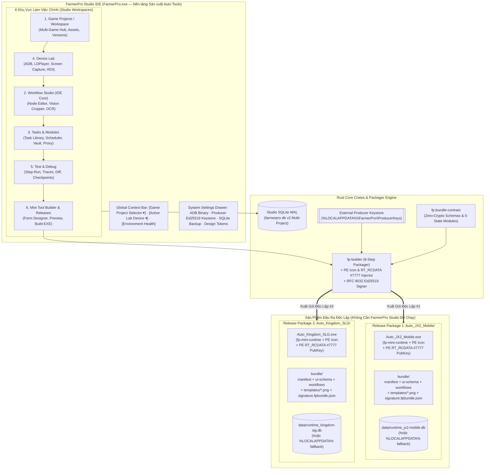
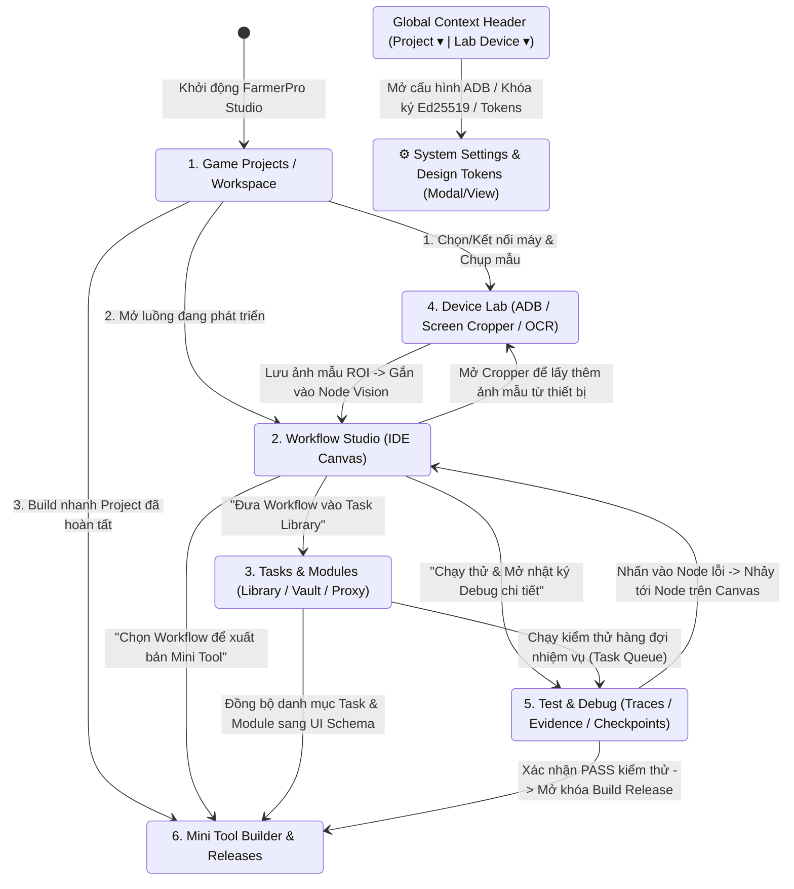
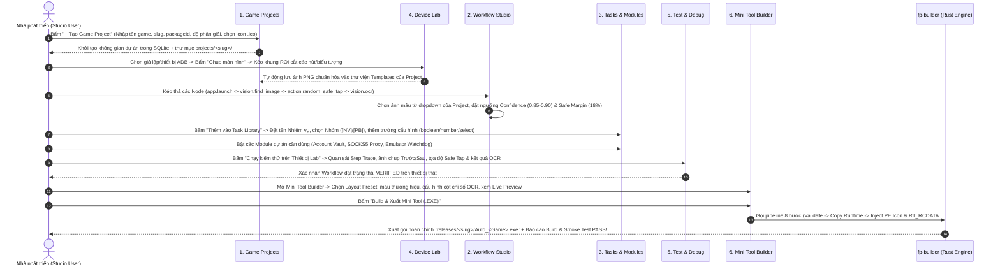

# FARMERPRO P1.2 — PRODUCT ARCHITECTURE, STUDIO IDE UX BLUEPRINT & P2 SCHEMA SPECIFICATION

> [!IMPORTANT]
> **Mục tiêu Kiến trúc Bắt buộc (P1.2 Gate trước khi triển khai P2/P4)**:
> - **Định vị lại sản phẩm**: `FarmerPro.exe` là **Studio IDE / Software Factory trung tâm** dùng để thiết kế, kiểm thử và sản xuất hàng loạt **Mini Auto-Tools độc lập (`Auto_<Game>.exe`)** cho nhiều tựa game khác nhau — tuyệt đối không phải là một màn hình điều khiển Võ Hiệp 2 Mobile mở rộng.
> - **Tuân thủ kỷ luật triển khai (Mục IX)**: Tài liệu thiết kế P1.2 này được trình duyệt đầy đủ trước khi khóa schema P2 và refactor UI P4. Mã nguồn giao diện `apps/desktop/src` và cơ sở dữ liệu production (`farmerpro.db`) được giữ nguyên 100%, không bị thay đổi trước khi duyệt.
> - **Hoàn thành đồng thời 2 yêu cầu kỹ thuật bắt buộc (Mục VIII)**:
>   1. **Đối chiếu & khôi phục toàn bộ danh mục Unit Tests**: Giải trình chi tiết chênh lệch `32` tests (P1-PoC) vs `31` tests (P1.1), khôi phục 2 bài test bị lược bỏ khi tách crate và bổ sung 1 bài test mới cho PE Root of Trust $\rightarrow$ đạt **`34/34 PASS`** trên toàn workspace ([cargo_test_workspace_p1_2.log](file:///e:/DATA/FarmerPro/artifacts/p1_2_evidence/cargo_test_workspace_p1_2.log)).
>   2. **Cứng hóa Nguồn Tin Cậy (Root of Trust) của Public Key ký Bundle**: Nhúng cứng khóa công khai 32-byte Ed25519 trực tiếp vào tài nguyên thực thi Windows PE **`RT_RCDATA` (#10), Resource ID `7777`** bên trong file `.exe` của Mini Tool ở Step 5 (`fp-builder`), và bắt buộc `fp-mini-runtime.exe` đọc khóa công khai gốc trực tiếp từ chính PE resource của tiến trình đang chạy. Kẻ tấn công **không thể** tự sinh cặp khóa mới rồi ghi đè `bundle/trusted_publisher.pub` + `bundle/signature.fpbundle.json` trong thư mục phát hành ([tamper_suite_5_cases_pe_root_of_trust.json](file:///e:/DATA/FarmerPro/artifacts/p1_2_evidence/tamper_suite_5_cases_pe_root_of_trust.json)).

---

## 1. PRODUCT ARCHITECTURE DIAGRAM MỚI (STUDIO IDE $\rightarrow$ STANDALONE MINI AUTO-TOOLS)

### 1.1. Sơ đồ Kiến trúc Sản phẩm Tổng thể



### 1.2. Phân tách Trách nhiệm Rạch ròi: Studio IDE vs Mini Tool Runtime

| Tiêu chí | `FarmerPro.exe` (FarmerPro Studio IDE) | `Auto_<Game>.exe` (Standalone Mini Auto-Tool) |
|---|---|---|
| **Vai trò cốt lõi** | Nhà máy sản xuất phần mềm Auto Game (IDE cho nhà phát triển quy trình). | Sản phẩm thương mại cuối cùng giao cho người chơi của một tựa game cụ thể. |
| **Phạm vi dữ liệu** | Đa dự án (`Multi-Project`), hàng trăm workflows, thư viện ảnh mẫu gốc, lịch sử kiểm thử và lịch sử bản dựng. | Chỉ chứa duy nhất gói `bundle/` đã đóng băng và ký số Ed25519 của 1 tựa game. |
| **Khóa mật mã** | Sở hữu `ProducerKeyManager` kết nối kho khóa ngoài (`active_producer_ed25519.json`) để ký gói khi xuất bản. | **Không chứa `fp-builder`, không có hàm ký, không có khóa bí mật.** Chỉ đọc khóa công khai `VerifyingKey` nhúng cứng trong PE `RT_RCDATA #7777` của chính file `.exe`. |
| **Giao diện (UI)** | Màn hình rộng chuẩn IDE (`1280×720` đến `1920×1080`), 6 phân hệ sản xuất + Execution Dock + Node Canvas. | Form điều khiển gọn nhẹ (`680×620` / `740×660`), render động 100% từ `bundle/ui-schema.json`. |
| **Tài nguyên Vault & Proxy** | Cấu hình dưới dạng **Project Modules** (`mod.account_vault`, `mod.proxy_network`) để gắn vào từng dự án game. | Chỉ khởi tạo và hiển thị các module đã được cấp phép trong `manifest.fpbundle.json` (Mô hình 5 trạng thái). |

---

## 2. INFORMATION ARCHITECTURE (IA) CỦA FARMERPRO STUDIO

Cấu trúc thông tin của FarmerPro Studio chuyển từ mô hình **"10 tab vận hành phẳng"** sang mô hình **"Context-Driven IDE gồm 6 Khu vực Làm việc Chính + 1 Khu vực Hệ thống"**:

```text
FARMERPRO STUDIO (IDE ROOT)
│
├── [A] GLOBAL CONTEXT HEADER (Luôn hiển thị ở đỉnh ứng dụng - Cao 44px)
│   ├── Project Switcher Dropdown: [🎮 Project đang mở: Võ Hiệp 2 Mobile (v1.0.0) ▾] (+ Nút "Tạo Project mới")
│   ├── Active Lab Device Target:  [📱 Thiết bị Lab: SM_X710N (emulator-5554) · ONLINE ▾] (+ Nút "Chụp nhanh")
│   ├── Contextual Primary Action: (Thay đổi theo khu vực đang mở: Validate / Run Workflow / Build Release)
│   └── System & Window Controls:  [⚙️ Settings] · [Minimize] · [Maximize] · [Close]
│
├── [B] PRIMARY WORKSPACE NAVIGATION (6 Khu vực sản xuất chính trên Sidebar)
│   │
│   ├── 1. GAME PROJECTS / WORKSPACE (Trung tâm Quản trị Dự án & Không gian làm việc)
│   │   ├── 1.1. Workspace Dashboard (Dự án gần đây, Trạng thái hoàn thiện, Thiết bị Lab sẵn sàng, Build gần nhất)
│   │   ├── 1.2. Project Manifest & Metadata (Tên game, Slug, Android Package ID, Độ phân giải chuẩn, Logo .ico/.png)
│   │   ├── 1.3. Asset & Template Library (Quản lý tập trung ảnh mẫu PNG, vùng cắt ROI, biến môi trường của Project)
│   │   └── 1.4. Project Health & Warnings (Cảnh báo workflow thiếu template, task chưa gán workflow, module thiếu quyền)
│   │
│   ├── 2. WORKFLOW STUDIO (Môi trường Thiết kế Đồ thị Tự động hóa — Trái tim của IDE)
│   │   ├── 2.1. Project Workflow Explorer & Collapsible Node Palette (Danh sách luồng của Project + Nhóm Node)
│   │   ├── 2.2. React Flow Interactive Graph Canvas (Auto-Layout, Fit View, Zoom, MiniMap, Safe-Tap Margin Preview)
│   │   ├── 2.3. Contextual Node Inspector (Cấu hình tham số Node, chọn ảnh mẫu Vision, ngưỡng Confidence, Retry, OCR)
│   │   ├── 2.4. Bottom Execution & Debug Dock (Step Trace trực tiếp, Biến Runtime, Ảnh chụp đối chiếu, Checkpoints)
│   │   └── 2.5. Bridge Actions: [Đưa vào Task Library] · [Chạy thử trên Device Lab] · [Chuyển sang Mini Tool Builder]
│   │
│   ├── 3. TASKS & MODULES (Đóng gói Nghiệp vụ Game & Cấu hình Module Tái sử dụng)
│   │   ├── 3.1. Task Library & Categories (Ánh xạ Workflow -> Nhiệm vụ người dùng, Nhóm danh mục [NV]/[PB]/[HĐ], Tham số)
│   │   ├── 3.2. Execution Policy & Scheduler (Thứ tự ưu tiên, thời gian ước tính, điều kiện tiên quyết, chính sách lặp)
│   │   ├── 3.3. Module: Account Vault (`mod.account_vault` — Quản lý hồ sơ tài khoản theo namespace của Project)
│   │   ├── 3.4. Module: Network & Proxy (`mod.proxy_network` / `mod.adb_port_forward` — SOCKS5/HTTP & ADB Socket Rules)
│   │   └── 3.5. Module: Utility Toggles & Watchdog (`mod.emulator_optimizer` — Tự kết nối lại, công tắc tiện ích phụ)
│   │
│   ├── 4. DEVICE LAB (Phòng Thử nghiệm Thiết bị Thực & Giả lập Android)
│   │   ├── 4.1. Unified Device & Emulator Fleet (ADB USB/TCP, Quét dải IP LAN, Điều khiển nhanh LDPlayer instances)
│   │   ├── 4.2. On-Demand Screen Inspector & ROI Template Cropper (Chụp PNG thật, kéo cắt ảnh mẫu lưu thẳng vào Project)
│   │   ├── 4.3. Live Vision & WinRT OCR Sandbox (Thử nghiệm so khớp SSD đa tỉ lệ và quét chữ OCR trên khung hình vừa chụp)
│   │   └── 4.4. Android Package & Resolution Inspector (Danh sách package đã cài, kiểm tra `wm size` & xoay màn hình)
│   │
│   ├── 5. TEST & DEBUG (Trung tâm Kiểm thử, Đối chiếu Bằng chứng & Nghiệm thu)
│   │   ├── 5.1. Live Step-Run & Execution Monitor (Theo dõi từng bước `command_sent` -> `device_ack` -> `verification_passed`)
│   │   ├── 5.2. Visual Evidence Inspector (Đối chiếu ảnh chụp Trước/Sau, khung Bounding Box và điểm chạm Safe Random Tap)
│   │   ├── 5.3. Checkpoint & Recovery Manager (Danh sách điểm lưu trạng thái SQLite WAL, khôi phục chạy tiếp khi gián đoạn)
│   │   └── 5.4. Multi-Device Stress & Acceptance Runner (Kiểm thử song song nhiều thiết bị, kiểm chứng Lease & Fencing)
│   │
│   └── 6. MINI TOOL BUILDER & RELEASES (Dây chuyền Thiết kế Giao diện, Đóng gói & Phát hành EXE)
│       ├── 6.1. Mini Tool UI Form Designer (Chọn Layout Preset, Màu chủ đạo, Cột chỉ số OCR động, Sắp xếp nhóm Task)
│       ├── 6.2. Module & Capability Selector (Bật/tắt 6 module theo mô hình 5 trạng thái, kiểm tra quyền truy cập)
│       ├── 6.3. Live Interactive Mini Tool Preview (Khung xem trước giao diện Mini Tool theo thời gian thực ngay trong Studio)
│       ├── 6.4. Pre-Flight Dependency & Security Audit (Kiểm tra đủ workflow, template, icon `.ico`, khóa ký Ed25519, ADB)
│       └── 6.5. Build EXE, Smoke Test & Release History (Chạy pipeline 8 bước, nhúng PE Icon + RT_RCDATA #7777, xuất ZIP/EXE)
│
└── [C] SYSTEM SETTINGS & DESIGN TOKENS (Khu vực Hệ thống — Mở từ nút ⚙️ ở đáy Sidebar hoặc Header)
    ├── System Tab 1: ADB & Emulator Paths (Đường dẫn `./bin/adb.exe`, thư mục cài đặt LDPlayer/Nox/BlueStacks)
    ├── System Tab 2: Producer Ed25519 Keystore (Xem Fingerprint khóa công khai, xoay vòng khóa `Rotate Key`, sao lưu khóa)
    ├── System Tab 3: Database & Backup Management (SQLite WAL status, Online Backup, `PRAGMA integrity_check`, Restore)
    └── System Tab 4: Design Tokens & IDE Rubric (Bảng màu Dark Precision, Typography, khoảng cách chuẩn từ `FARMERPRO_DESIGN_TOKENS.json`)
```

---

## 3. NAVIGATION MAP & NGUYÊN TẮC KHÔNG NHÂN BẢN ĐIỀU KHIỂN

### 3.1. Sơ đồ Điều hướng Toàn Ứng dụng (Navigation Map)



### 3.2. Quy tắc Chống Nhân bản Thao tác (Anti-Duplication Rules — Mục IV & VII)
Trong giao diện cũ, các nút **"Mở App / Tắt App / Quét ADB / Khởi động LDPlayer / Chạy Luồng"** bị lặp lại ở cả `AppHeader`, `OverviewView`, `DevicesView` và `TasksView`. Kiến trúc mới áp dụng quy tắc phân quyền điều khiển duy nhất:
1. **Global Header**: Chỉ giữ **2 bộ chọn ngữ cảnh (Context Selectors)**:
   - `Active Game Project ▾` (Dự án game nào đang được chỉnh sửa).
   - `Active Lab Device ▾` (Thiết bị Android nào đang được dùng làm mục tiêu thử nghiệm).
   - Loại bỏ hoàn toàn cụm nút "Mở App / Tắt App" khỏi Global Header để tránh bấm nhầm khi đang thiết kế đồ thị.
2. **Thao tác quản lý phần cứng thiết bị (Quét IP LAN, Bật/Tắt LDPlayer, Mở/Đóng Package, Chụp & Cắt ảnh mẫu ROI)**: Chỉ đặt duy nhất tại **`4. Device Lab`**.
3. **Thao tác kiểm tra cú pháp & chạy thử luồng đơn (`Validate Graph`, `Test Run Workflow`, `Step Debug`)**: Chỉ đặt tại thanh công cụ ngữ cảnh của **`2. Workflow Studio`** và **`5. Test & Debug`**.
4. **Thao tác đóng gói & xuất bản (`Build Mini Tool EXE`, `Verify Signature`, `Export Release`)**: Chỉ đặt duy nhất tại **`6. Mini Tool Builder & Releases`**.

---

## 4. USER FLOW BẮT BUỘC: TỪ TẠO GAME PROJECT ĐẾN XUẤT MINI TOOL EXE

Nhà phát triển thực hiện trọn vẹn **7 bước sản xuất** bên trong giao diện đồ họa của FarmerPro Studio mà **không cần sửa file JSON thủ công và không cần mở cửa sổ dòng lệnh Cargo**:



---

## 5. WIREFRAME 6 KHU VỰC CHÍNH CỦA FARMERPRO STUDIO

### 5.1. Khu vực 1: `Game Projects / Workspace` (Thay thế Dashboard Vận hành Cũ)
Dashboard không còn là bảng điều khiển chạy auto cho một game duy nhất, mà trở thành **Trung tâm Quản trị Không gian Sản xuất (Workspace Hub)**:

```text
+----------------------------------------------------------------------------------------------------------------------+
| [Bot] FarmerPro Studio IDE   | Project: [🎮 Võ Hiệp 2 Mobile (v1.0.0) ▾] | Lab Device: [📱 SM_X710N (ONLINE) ▾] | ⚙️ |
+----------------------+-----------------------------------------------------------------------------------------------+
| WORKSPACE            |  GAME PROJECTS & WORKSPACE HUB                                [+ Tạo Game Project Mới]        |
|                      |  Quản lý danh mục dự án game, tiến độ hoàn thiện workflow, thiết bị Lab và bản dựng gần nhất. |
| [■] 1. Projects      |-----------------------------------------------------------------------------------------------|
| [ ] 2. Workflow      |  DỰ ÁN GAME ĐANG PHÁT TRIỂN (ACTIVE GAME PROJECTS - Dữ liệu thật từ SQLite/Disk)              |
| [ ] 3. Tasks/Modules |  +---------------------------------------------+ +------------------------------------------+ |
| [ ] 4. Device Lab    |  | [ICO] Võ Hiệp Truyền Kỳ 2 Mobile    [ACTIVE]| | [ICO] Kingdom Rise: Tactics SLG  [READY] | |
| [ ] 5. Test & Debug  |  | Slug: jx2-mobile | Pkg: com.blackhole.jx2   | | Slug: kingdom-slg | Pkg: com.kingdom.slg | |
| [ ] 6. Mini Builder  |  | • Workflows: 10 luồng (2 đã kiểm chứng ADB) | | • Workflows: 1 luồng (Thu hoạch & Kỵ)    | |
|                      |  | • Tasks: 5 nhiệm vụ | Templates: 4 ảnh PNG  | | • Tasks: 4 nhiệm vụ | Templates: 3 PNG   | |
|                      |  | • Modules: ADB, Vision, Vault, Proxy, Watch | | • Modules: ADB, Vision, Vault, Watchdog  | |
|                      |  | • Release gần nhất: Auto_JX2_Mobile.exe     | | • Release gần nhất: Auto_Kingdom_SLG.exe | |
|                      |  | [Mở Workflow Studio] [Cấu hình Project] [Build]| | [Mở Workflow Studio] [Chuyển sang Dự án] | |
|                      |  +---------------------------------------------+ +------------------------------------------+ |
|                      |-----------------------------------------------------------------------------------------------|
|                      |  TRẠNG THÁI DÂY CHUYỀN SẢN XUẤT (PROJECT PIPELINE HEALTH)                                     |
|                      |  +---------------------------+ +----------------------------+ +-----------------------------+ |
|                      |  | THIẾT BỊ LAB SẴN SÀNG     | | KIỂM THỬ (TEST RUNS) GẦN ĐÂY| | BẢN DỰNG & CẢNH BÁO DỰ ÁN  | |
|                      |  | • emulator-5554 (SM_X710N)| | • wf-jx2-live-adb: PASS    | | • Auto_JX2_Mobile v1.0.0    | |
|                      |  |   1280x720 · Android 14   | |   19 events · Tap(111,170) | |   PE RT_RCDATA #7777: OK    | |
|                      |  |   [Mở Device Lab ->]      | |   [Xem bằng chứng ->]      | | • 0 lỗi thiếu ảnh mẫu       | |
|                      |  +---------------------------+ +----------------------------+ +-----------------------------+ |
|----------------------+-----------------------------------------------------------------------------------------------|
| 🟢 ADB Portable      |  SQLite WAL: OK | Producer Key: fp-ed25519-acb43ebd9ab4 | Active Project: jx2-mobile          |
+----------------------------------------------------------------------------------------------------------------------+
```

### 5.2. Khu vực 2: `Workflow Studio` (Trung tâm Thiết kế Đồ thị Tự động hóa)

```text
+----------------------------------------------------------------------------------------------------------------------+
| [Bot] FarmerPro Studio IDE   | Project: [🎮 Võ Hiệp 2 Mobile ▾] | Device: [📱 emulator-5554 ▾] | [Kiểm tra] [▶ Chạy] |
+--------------+-------------------+--------------------------------------------------------+--------------------------+
| WORKSPACE    | WORKFLOWS & NODES | WORKFLOW CANVAS: [wf-jx2-live-adb-probe]               | NODE INSPECTOR           |
|              |                   | Toolbar: [Sắp xếp tự động] [Fit View] [MiniMap] [100%] |                          |
| [ ] Projects | ▼ Luồng trong Dự án|                                                        | Đang chọn:               |
| [■] Workflow | • Chính Tuyến Dã  |   +--------------+     +--------------------+          | [vision.find_image]      |
| [ ] Tasks    | • [Đang mở] ADB   |   |  flow.start  | --> |   vision.capture   |          | ID: n-find-sys           |
| [ ] Device   |   [+ Tạo luồng]   |   +--------------+     +--------------------+          |--------------------------|
| [ ] Test Lab |-------------------|                                  |                     | Ảnh mẫu (Template PNG):  |
| [ ] Builder  | ▼ Node Palette    |                                  v                     | [live_ldplayer_sys.. ▾]  |
|              | [+ Luồng & ĐK]    |   +--------------------+     +--------------------+    | [Xem ảnh] [Cắt từ Lab]   |
|              | [+ Thị giác/OCR]  |   | action.random_safe | <-- | vision.find_image  |    |                          |
|              |   - vision.capture|   | marginRatio: 0.18  |     | confidence: 0.90   |    | Ngưỡng khớp (Confidence):|
|              |   - find_image    |   +--------------------+     +--------------------+    | [=======●==] 0.90        |
|              |   - vision.ocr    |             |                                          |                          |
|              | [+ Thao tác ADB]  |             v                                          | Chính sách thử lại:      |
|              |   - random_tap    |   +--------------------+     +--------------------+    | Số lần Retry: [ 3 ]      |
|              |   - swipe         |   |    vision.ocr      | --> |  state.checkpoint  |    | Timeout (ms): [ 5000 ]   |
|              | [+ Trạng thái]    |   +--------------------+     +--------------------+    |--------------------------|
|              |   [<< Thu gọn]    |                                                        | [+ Đưa vào Task Library] |
|              +-------------------+--------------------------------------------------------+--------------------------|
|              | EXECUTION & DEBUG DOCK (Có thể thu gọn 36px / mở rộng 200px)                      [Mở rộng / Thu gọn] |
|              | Tabs: [● Step Trace (19)] [Ảnh Chụp & Khớp Mẫu] [Biến Runtime (ocr_text)] [Checkpoints (1)]           |
|              | 16:28:53.035 | n-find-sys | verification_passed | score=1.000, target=(74.0, 135.0)                   |
|              | 16:28:53.151 | n-tap-sys  | device_ack          | input tap 111 170 (Safe Margin 18%)                 |
+--------------+-------------------------------------------------------------------------------------------------------+
```

### 5.3. Khu vực 3: `Tasks & Modules` (Thư viện Nhiệm vụ & Cấu hình Module theo Dự án)

```text
+----------------------------------------------------------------------------------------------------------------------+
| [Bot] FarmerPro Studio IDE   | Project: [🎮 Võ Hiệp 2 Mobile (jx2-mobile) ▾] | Lab Device: [📱 emulator-5554 ▾] | ⚙️ |
+----------------------+-----------------------------------------------------------------------------------------------+
| WORKSPACE            |  TASKS & PROJECT MODULES (Cấu hình nghiệp vụ & tài nguyên tái sử dụng cho Project đang mở)   |
|                      |  Sub-Tabs: [● 1. Task Library (5)] [2. Categories (3)] [3. Account Vault] [4. Proxy & Network]|
| [ ] 1. Projects      |-----------------------------------------------------------------------------------------------|
| [ ] 2. Workflow      |  DANH SÁCH NHIỆM VỤ ĐƯỢC XUẤT BẢN TRONG MINI TOOL              [+ Tạo Task từ Workflow]       |
| [■] 3. Tasks/Modules |  +------------------------------------------------------------------------------------------+ |
| [ ] 4. Device Lab    |  | Thứ tự | Nhóm | Tên Nhiệm vụ hiển thị trên Mini Tool | Workflow liên kết      | Tham số  | |
| [ ] 5. Test & Debug  |  |--------|------|--------------------------------------|------------------------|----------| |
| [ ] 6. Mini Builder  |  | #1 [▲▼]| [NV] | Chính Tuyến & Đối thoại Dã Tẩu       | wf-jx2-main-quest      | 2 fields | |
|                      |  | #2 [▲▼]| [NV] | Tìm Kho Báu & Đào Tàng Bảo Đồ        | wf-jx2-main-quest      | 1 field  | |
|                      |  | #3 [▲▼]| [PB] | Sơn Tặc Mật Quật & Bí Cảnh Tổ Đội    | wf-jx2-main-quest      | 1 field  | |
|                      |  | #4 [▲▼]| [HĐ] | Lửa Trại Bang & Chiến Trường Tống Kim| wf-jx2-main-quest      | 0 fields | |
|                      |  | #5 [▲▼]| [NV] | Kiểm tra Thiết bị ADB Thật + OCR     | wf-jx2-live-adb-probe  | 0 fields | |
|                      |  +------------------------------------------------------------------------------------------+ |
|                      |  CHI TIẾT THAM SỐ TASK ĐANG CHỌN (#1: Chính Tuyến & Đối thoại Dã Tẩu)                         |
|                      |  • Field 1: key=`auto_skip_dialog` | kiểu=`boolean` | nhãn="Tự động bỏ qua hội thoại NPC"     |
|                      |  • Field 2: key=`max_quest_loops`  | kiểu=`number`  | nhãn="Số chuỗi Dã Tẩu tối đa" (Mặc định:10)|
|                      |  [+ Thêm Tham Số Cấu Hình Cho Task Này]                       [Đồng bộ sang Mini Tool Builder]|
+----------------------+-----------------------------------------------------------------------------------------------+
```
*(Lưu ý: Khi chuyển sang Sub-Tab **[3. Account Vault]** và **[4. Proxy & Network]**, toàn bộ tính năng quản lý tài khoản theo `CRED_MGR://` và kiểm tra SOCKS5/HTTP Proxy + bảng `adb forward/reverse` cùng cảnh báo giới hạn UDP/System Proxy từ 2 màn hình cũ được giữ nguyên 100%, nhưng được gắn đúng vào ngữ cảnh của Project đang chọn!)*

### 5.4. Khu vực 4: `Device Lab` (Phòng Thử nghiệm Thiết bị, Chụp Màn hình & Cắt Mẫu ROI)

```text
+----------------------------------------------------------------------------------------------------------------------+
| [Bot] FarmerPro Studio IDE   | Project: [🎮 Võ Hiệp 2 Mobile ▾] | Lab Device: [📱 SM_X710N (emulator-5554) ▾]   | ⚙️ |
+----------------------+-----------------------------------+-----------------------------------------------------------+
| WORKSPACE            | DANH SÁCH THIẾT BỊ & GIẢ LẬP      | MÀN HÌNH SNAPSHOT & CÔNG CỤ CẮT MẪU VISION (ROI CROPPER)  |
|                      | [Quét lại ADB] [Quét IP LAN]      | Thiết bị: emulator-5554 (1280x720 · Android 14 · 0 deg)   |
| [ ] 1. Projects      |-----------------------------------| Toolbar: [📸 Chụp màn hình mới] [✂️ Kéo cắt ROI] [🔍 Test OCR]|
| [ ] 2. Workflow      | 🟢 SM_X710N (emulator-5554)       | +-------------------------------------------------------+ |
| [ ] 3. Tasks/Modules |    1280x720 · API 34 · READY      | |                                                       | |
| [■] 4. Device Lab    |-----------------------------------| |    +-----------------+                                | |
| [ ] 5. Test & Debug  | ĐIỀU KHIỂN NHANH LDPLAYER         | |    | [ROI: 74, 135]  |  <-- Khung kéo cắt trực quan   | |
| [ ] 6. Mini Builder  | • Index 0: LDPlayer-Main (Running)| |    |  System Apps    |      trên ảnh PNG 1280x720     | |
|                      |   [Khởi động] [Tắt] [Reboot]      | |    +-----------------+                                | |
|                      |-----------------------------------| |                                                       | |
|                      | QUẢN LÝ PACKAGE TRÊN THIẾT BỊ     | +-------------------------------------------------------+ |
|                      | App: [🎮 Võ Hiệp 2 Mobile ▾]      | LƯU MẪU VỪA CẮT VÀO PROJECT (`projects/jx2-mobile/templates/`)|
|                      | [▶ Mở App] [■ Tắt App] [Làm mới]  | Tên file mẫu: [live_ldplayer_system_apps.png]             |
|                      |-----------------------------------| Kích thước vùng cắt: 88x88 px tại tọa độ gốc (74, 135)    |
|                      | Kết nối TCP/IP: [127.0.0.1:5555]  | [💾 Lưu vào Project Templates] [🧪 Chạy thử khớp mẫu SSD] |
+----------------------+-----------------------------------+-----------------------------------------------------------+
```

### 5.5. Khu vực 5: `Test & Debug` (Kiểm thử Bước, Đối chiếu Bằng chứng & Checkpoints)

```text
+----------------------------------------------------------------------------------------------------------------------+
| [Bot] FarmerPro Studio IDE   | Project: [🎮 Võ Hiệp 2 Mobile ▾] | Lab Device: [📱 SM_X710N (emulator-5554) ▾]   | ⚙️ |
+----------------------+---------------------------------------+-------------------------------------------------------+
| WORKSPACE            | NHẬT KÝ PHIÊN CHẠY & SỰ KIỆN BƯỚC     | BẰNG CHỨNG THỊ GIÁC & TRẠNG THÁI CHECKPOINT           |
|                      | Phiên: mini-job-6bb41a50 (SUCCEEDED)  | Bước đang chọn: #6 `n-tap-sys` (`action.random_safe_tap`)|
| [ ] 1. Projects      | [▶ Chạy kiểm thử mới] [■ Dừng khẩn]   |-------------------------------------------------------|
| [ ] 2. Workflow      |---------------------------------------| ĐỐI CHIẾU ẢNH CHỤP TRƯỚC / SAU & TỌA ĐỘ SAFE TAP      |
| [ ] 3. Tasks/Modules | #1 n-start    | command_sent          | +-------------------------+ +-----------------------+ |
| [ ] 4. Device Lab    | #2 n-cap      | device_ack (720x1280) | | ẢNH TRƯỚC (SHA: 685df..)| | ẢNH SAU (SHA: 9ee0f..)| |
| [■] 5. Test & Debug  | #4 n-find-sys | verification_passed   | | Khớp mẫu SSD: 1.000     | | Hộp thoại System Apps | |
| [ ] 6. Mini Builder  |    -> score=1.00, target=(74, 135)    | | Vùng khớp: [74,135,88,88| | đã mở thành công!     | |
|                      | #6 n-tap-sys  | device_ack            | | Safe Tap: ● (111, 170)  | |                       | |
|                      |    -> input tap 111 170 (margin 18%)  | +-------------------------+ +-----------------------+ |
|                      | #10 n-ocr     | verification_passed   | KẾT QUẢ WINRT OCR & CHECKPOINT SQLITE WAL             |
|                      |    -> "Cài đặt Files ... Cửa hàng Play"| • Biến `ocr_text`: "Cài đặt Files ... Cửa hàng Play"  |
|                      | #12 n-cp      | checkpoint_saved      | • Checkpoint: `live_adb_verified` (Đã lưu SQLite WAL) |
|                      |    -> name="live_adb_verified"        | [🔄 Khôi phục từ Checkpoint này] [Mở Node trên Canvas]|
+----------------------+---------------------------------------+-------------------------------------------------------+
```

### 5.6. Khu vực 6: `Mini Tool Builder & Releases` (Tích hợp Bắt buộc trong Studio — Mục V)

```text
+----------------------------------------------------------------------------------------------------------------------+
| [Bot] FarmerPro Studio IDE   | Project: [🎮 Võ Hiệp 2 Mobile (jx2-mobile) ▾] | [🔍 Kiểm tra Pre-Flight] [🚀 Build EXE]|
+----------------------+---------------------------------------------------+-------------------------------------------+
| WORKSPACE            | CẤU HÌNH SẢN PHẨM MINI TOOL (NO-CODE BUILDER)     | LIVE INTERACTIVE PREVIEW (XEM TRƯỚC THẬT) |
|                      | Sub-Tabs: [● 1. Giao diện & Cột] [2. Modules (5)] | Khung mô phỏng kích thước thực 740x660    |
| [ ] 1. Projects      |           [3. Build & Kiểm thử Release (2)]       | +---------------------------------------+ |
| [ ] 2. Workflow      |---------------------------------------------------| | [ICO] Auto Võ Hiệp 2 Mobile v1.0.0    | |
| [ ] 3. Tasks/Modules | 1. ĐỊNH DANH & THƯƠNG HIỆU SẢN PHẨM               | |---------------------------------------| |
| [ ] 4. Device Lab    | • Tên file EXE xuất ra: [Auto_JX2_Mobile.exe    ] | | Thiết bị        | Cấp      | Vàng     | |
| [ ] 5. Test & Debug  | • Tiêu đề cửa sổ:       [Auto Võ Hiệp 2 v1.0.0  ] | | emulator-5554   | Chưa OCR | Chưa OCR | |
| [■] 6. Mini Builder  | • Nhãn phiên bản:       [JX2-MMORPG v1.0        ] | |---------------------------------------| |
|                      | • Màu nhấn (Accent):    [#F59E0B] | Nền: [#18131A]| | NHIỆM VỤ (5)         | NHẬT KÝ        | |
|                      | • Biểu tượng PE (.ico): [branding/icon.ico] [Đổi] | | [x] [NV] Chính Tuyến | [READY] Đã xác | |
|                      |---------------------------------------------------| | [x] [NV] Tìm Kho Báu | thực chữ ký    | |
|                      | 2. BỐ CỤC FORM & CỘT CHỈ SỐ ĐỘNG (DEVICE COLUMNS) | | [x] [PB] Sơn Tặc     | Ed25519...     | |
|                      | • Layout Preset: ( ) 1 Cột  (●) 2 Cột  ( ) Mở rộng| | [ ] [HĐ] Lửa Trại    |                | |
|                      | • Cột 1: Nhãn=`Cấp`  | Biến=`char_level`          | |---------------------------------------| |
|                      | • Cột 2: Nhãn=`Vàng` | Biến=`char_gold`           | | [▶ Chạy Nhiệm vụ]  ADB: 1 ONLINE      | |
|                      | • Cột 3: Nhãn=`Bạc`  | Biến=`char_silver`         | +---------------------------------------+ |
|                      | [+ Thêm cột chỉ số OCR động]                      | TRẠNG THÁI PIPELINE ĐÓNG GÓI 8 BƯỚC       |
|                      |---------------------------------------------------| ✅ Step 1-4: Validate & Copy Runtime      |
|                      | 3. LỰA CHỌN MODULE ĐƯỢC CẤP PHÉP ĐÓNG GÓI         | ✅ Step 5: Nhúng PE Icon + RT_RCDATA #7777|
|                      | [x] mod.adb_core (Core)  [x] mod.vision_ocr (Core)| ✅ Step 6-8: Ký Ed25519 & Verify Bundle   |
|                      | [x] mod.account_vault    [x] mod.proxy_network    | [📂 Mở thư mục Release] [🧪 Smoke Test]   |
+----------------------+---------------------------------------------------+-------------------------------------------+
```

---

## 6. THIẾT KẾ CHI TIẾT `WORKFLOW STUDIO` DESKTOP & `MINI TOOL BUILDER`

### 6.1. Đặc tả Kỹ thuật Giao diện `Workflow Studio` (Mục IV & VII)
1. **Phân bổ Không gian Hiển thị trên 3 Độ phân giải Mục tiêu**:
   - **Global Header**: Cao cố định `44px`.
   - **Status Bar**: Cao cố định `26px`.
   - **NavRail (Sidebar trái)**: Rộng `220px` khi mở rộng, thu gọn còn `60px` (chỉ hiện icon + tooltip) để nhường tối đa diện tích cho Canvas trên màn hình `1280×720`.
   - **Node Palette + Project Workflow List**: Rộng `240px`, có nút thu gọn (`Collapse`) về `0px` (mở lại qua nút nổi trên góc trái Canvas).
   - **Node Inspector (Bên phải)**: Rộng `300px`, tự động hiển thị khi chọn Node và có nút đóng/mở trên `CanvasToolbar`.
   - **Execution & Debug Dock (Phía dưới Canvas)**: Cao `36px` ở chế độ thu gọn (chỉ hiện thanh trạng thái bước cuối) và `210px` khi mở rộng.
   - **Diện tích thực tế của React Flow Canvas**:
     - Ở `1280×720` (khi thu gọn NavRail `60px` + Palette `0px`, mở Inspector `300px`):
       - Với Execution Dock thu gọn (`36px`): **`920×614 px`** (`564,880 px²` $\approx$ **`61,3%`** tổng diện tích cửa sổ `1280×720`, trong đó chiều rộng `920 px` chiếm **`71,9%`** chiều rộng cửa sổ và **`75,4%`** chiều rộng vùng nội dung khả dụng sau NavRail).
       - Với vùng Canvas đo ở cấu hình dock/toolbar mở rộng (`920×510 px` như chú thích trên mockup `Ảnh 03A`): `920×510 px` (`469,200 px²`) tương ứng **`~50,9%`** tổng diện tích cửa sổ `1280×720` (`921,600 px²`), trong khi chiều rộng `920 px` chiếm **`~71,9%`** chiều rộng cửa sổ. *(Đã hiệu chỉnh chuẩn đo lường theo phản hồi P1.2 `v1.2.1-REVIEW` Mục II.1 trước khi áp dụng cho nghiệm thu P4).*
     - Ở `1600×900`: **`840×620 px`** (khi mở đủ mọi panel) đến **`1240×794 px`** (khi thu gọn panel phụ).
     - Ở `1920×1080`: **`1160×800 px`** (mở đủ mọi panel) đến **`1560×974 px`**.
2. **Tích hợp Trực tiếp Các Hành động Cầu nối (Bridge Actions)**:
   - Ngay trên thanh Inspector của Workflow Studio có nút **`[+ Đưa vào Task Library]`**: Mở hộp thoại tạo `MiniTaskDef` liên kết trực tiếp với `workflowId` hiện tại mà không cần copy/paste ID thủ công.
   - Nút **`[✂️ Cắt ảnh mẫu từ Device Lab]`** ngay trong thuộc tính `templateRef` của Node `vision.find_image`: Cho phép chụp màn hình từ thiết bị Lab đang chọn và cắt vùng ROI lưu thành file `.png` ngay lập tức.
   - Khi một Node gặp lỗi trong `Execution Dock`, bấm vào dòng log lỗi sẽ tự động `fitView` và tô sáng (highlight) đúng Node đó trên Canvas để sửa tham số.

### 6.2. Đặc tả Kỹ thuật `Mini Tool Builder` (Mục V)
1. **Không Hardcode theo Võ Hiệp 2 Mobile**:
   - Mọi thành phần giao diện của Mini Tool đều được sinh từ cấu trúc `MiniToolUiSchema` (trong `crates/fp-bundle-contract`):
     - `layout_preset`: Hỗ trợ 3 kiểu bố cục (`compact_1_col`, `compact_2_col`, `expanded`).
     - `device_columns`: Người phát triển tự định nghĩa các cột hiển thị trên bảng thiết bị (ví dụ Game MMORPG tạo cột `Cấp`, `Vàng`, `Bạc` gắn với biến OCR `char_level`, `char_gold`; Game Chiến thuật SLG tạo cột `Thành Chính`, `Lương Thực`, `Gỗ`, `Quân Lực` gắn với biến `castle_tier`, `food_stock`...). Tất cả các cột chưa qua OCR thực tế đều bắt buộc hiển thị `fallback_display: "Chưa OCR (-)"`.
     - `task_categories` & `tasks`: Tự định nghĩa nhãn viết tắt (`[NV]`, `[PB]`, `[Nông Nghiệp]`, `[Quân Sự]`), màu sắc badge, thứ tự ưu tiên và danh sách trường cài đặt (`boolean`, `number`, `select`, `text`).
2. **Quy trình Kiểm tra Trước Đóng gói (Pre-Flight Dependency & Security Checker)**:
   - Trước khi nút **`Build & Xuất Mini Tool (.EXE)`** thực thi, Builder chạy bộ kiểm tra 6 điểm:
     1. Tất cả `tasks` trong UI Schema đều trỏ tới `workflow_id` tồn tại và đã vượt qua `WorkflowValidator`.
     2. Tất cả các Node `vision.find_image` trong mọi workflow được chọn đều có file ảnh mẫu `.png` tồn tại thật trong `templates/` và đường dẫn hợp lệ (`validate_safe_relative_path`).
     3. Tất cả các `utilities` có khai báo `required_module` đều nằm trong danh sách `packaged_modules` đã được tích chọn.
     4. File biểu tượng `branding/icon.ico` tồn tại và có cấu trúc header ICO hợp lệ.
     5. Kho khóa nhà sản xuất `ProducerKeyManager` (`%LOCALAPPDATA%\FarmerPro\ProducerKeys\active_producer_ed25519.json`) sẵn sàng.
     6. Binary mẫu `fp-mini-runtime.exe` và bộ `./bin/adb.exe` sẵn sàng.
3. **Tích hợp Kiểm thử Bản phát hành (Release Smoke Test) Ngay trong Studio**:
   - Sau khi `MiniToolPackager::build_and_export_release` hoàn tất 8 bước (nhúng PE Icon + nhúng khóa công khai Ed25519 vào `RT_RCDATA #7777` + ký `signature.fpbundle.json`), người dùng có thể bấm nút **`[🧪 Kiểm thử Bản phát hành (Smoke Test)]`** ngay trên giao diện Studio:
     - Studio sẽ gọi tiến trình con `Auto_<Game>.exe --verify-bundle` và `Auto_<Game>.exe --test-tamper-suite` để xác nhận chữ ký số Ed25519, PE Root of Trust và kiểm tra môi trường độc lập trước khi đóng gói ZIP hoặc bàn giao.

---

## 7. BẢNG ÁNH XẠ 10 MÀN HÌNH CŨ SANG CẤU TRÚC 6 KHU VỰC MỚI (ĐẢM BẢO 0% MẤT CHỨC NĂNG)

Bảng dưới đây đối chiếu toàn bộ **10 màn hình hiện tại** trong `apps/desktop/src/features/*` sang kiến trúc Studio mới, đảm bảo giữ lại 100% tính năng và hàm backend đã có:

| STT | Màn hình cũ (`currentView`) | File nguồn hiện tại | Chuyển sang Khu vực Mới | Chi tiết Chức năng Được Giữ Lại & Tái Tổ Chức |
|---|---|---|---|---|
| **1** | **Tổng quan** (`overview`) | `features/overview/OverviewView.tsx` | **`1. Game Projects / Workspace`** | • Chuyển thành **Workspace Dashboard**: Hiển thị danh sách Game Projects, tiến độ hoàn thiện workflow, thiết bị Lab đang online, kết quả test gần nhất và bản release mới nhất.<br>• Các nút điều khiển phần cứng rời rạc (Mở/Tắt app, điều khiển LDPlayer) được gom gọn về `4. Device Lab` để tránh trùng lặp. |
| **2** | **Thiết bị Android** (`devices`) | `features/devices/DevicesView.tsx` | **`4. Device Lab`** | • Giữ nguyên 100% chức năng: Danh sách ADB USB/TCP, kết nối IP:Port trực tiếp, **Quét dải IP LAN (`scanRange`)**, **Tự động khám phá giả lập (`autoDiscover`)**, điều khiển **LDPlayer (`ldAction`: launch/quit/reboot)**, danh sách Packages (`launchApp`/`stopApp`), chụp màn hình `captureCurrentDevice`.<br>• **Bổ sung mới ở P4**: Khung cắt ảnh mẫu trực quan (ROI Template Cropper) lưu thẳng vào thư mục `templates/` của Project đang chọn. |
| **3** | **Kho Quy trình JX2** (`workflows`) | `features/workflows/WorkflowsView.tsx` | **`2. Workflow Studio`** *(Project Workflow Explorer)* & **`1. Game Projects`** | • Bỏ tên cứng "Kho Quy trình JX2".<br>• Toàn bộ 10 quy trình Võ Hiệp 2 Mobile hiện có (`jx2Workflows.ts`) được bảo toàn 100% dưới dạng bộ quy trình mẫu của dự án `jx2-mobile`.<br>• Danh sách quy trình trở thành **Project Workflow Explorer** lọc theo dự án đang mở (`project_id`). |
| **4** | **Workflow Studio** (`studio`) | `features/studio/WorkflowStudioView.tsx` | **`2. Workflow Studio`** *(Trung tâm IDE)* | • Giữ nguyên 100% React Flow Canvas, `CustomWorkflowNode`, `NodePalette`, `NodeInspector`, `ExecutionDock`, `autoLayout`, `fitView`, `MiniMap`.<br>• **Bổ sung mới ở P4**: Nút cầu nối *"Đưa vào Task Library"*, chọn ảnh mẫu trực tiếp từ Project Templates và nhảy từ log lỗi tới Node. |
| **5** | **Bộ Nhiệm vụ** (`tasks`) | `features/tasks/TasksView.tsx` | **`3. Tasks & Modules`** *(Sub-tab 1: Task Library & Queue)* | • Giữ nguyên toàn bộ tính năng danh mục nhiệm vụ, sắp xếp thứ tự ưu tiên (`priority`), bật/tắt nhiệm vụ, thời gian ước tính (`estimateSec`).<br>• Nâng cấp từ mảng tĩnh trong component thành **Task Library gắn với từng Workflow của Project** và xuất trực tiếp sang `ui-schema.json` của Mini Tool. |
| **6** | **Phiên chạy** (`runs`) | `features/runs/RunsView.tsx` | **`5. Test & Debug`** | • Giữ nguyên toàn bộ bảng sự kiện bước (`StepEvent`), chi tiết JSON payload, lọc theo thiết bị và khôi phục Checkpoint (`handleRestoreCheckpoint`).<br>• **Loại bỏ hoàn toàn mảng sự kiện giả lập mặc định (`job-demo-8492`)** khi chưa chạy thật — chỉ hiển thị dữ liệu thật từ SQLite `step_events` và ảnh chụp đối chiếu Trước/Sau. |
| **7** | **Tài khoản (Vault)** (`accounts`) | `features/accounts/AccountsView.tsx` | **`3. Tasks & Modules`** *(Sub-tab 3: Module Account Vault)* | • Giữ nguyên 100% giao diện và cơ chế quản lý hồ sơ tài khoản, trạng thái (`ready`, `in_session`, `cooldown`, `expired`) và tham chiếu khóa bảo mật `CRED_MGR://` (không lưu mật khẩu dạng rõ).<br>• Tổ chức lại thành cấu hình của module `mod.account_vault` theo từng Game Project. |
| **8** | **Mạng & Proxy** (`network`) | `features/network/NetworkView.tsx` | **`3. Tasks & Modules`** *(Sub-tab 4: Module Proxy & Network)* | • Giữ nguyên 100% công cụ kiểm tra độ trễ SOCKS5/HTTP Proxy, bảng quy tắc chuyển tiếp cổng ADB (`adb forward`/`reverse`), và **Banner cảnh báo kỹ thuật trung thực về giới hạn Android System Proxy / UDP game traffic**.<br>• Tổ chức lại thành cấu hình của module `mod.proxy_network` và `mod.adb_port_forward`. |
| **9** | **Design Tokens** (`gallery`) | `features/gallery/ComponentGalleryView.tsx` | **`⚙️ System Settings`** *(System Tab 4: Design Tokens & Rubric)* | • Giữ nguyên 100% bảng tra cứu màu sắc, typography và component rubric từ `FARMERPRO_DESIGN_TOKENS.json`, chuyển vào khu vực Hệ thống để không chiếm thanh điều hướng sản xuất chính. |
| **10** | **Cài đặt & ADB** (`settings`) | `features/settings/SettingsView.tsx` | **`⚙️ System Settings`** *(System Tabs 1–3)* | • Giữ nguyên toàn bộ chẩn đoán đường dẫn ADB, trạng thái cơ sở dữ liệu SQLite WAL, cấu hình hệ thống.<br>• **Bổ sung mới**: Quản lý khóa ký Ed25519 của nhà sản xuất (`ProducerKeyManager`: xem Public Key, xoay vòng khóa) và công cụ sao lưu/kiểm tra toàn vẹn SQLite (`Online Backup` + `PRAGMA integrity_check`). |
| *(Mới)* | *(Chưa có ở UI cũ)* | *(Mới hoàn toàn)* | **`6. Mini Tool Builder & Releases`** | • Phân hệ mới tích hợp trực tiếp `fp-bundle-contract` và `fp-builder` vào giao diện Studio: Thiết kế form Mini Tool, chọn module, xem Live Preview, chạy Pre-Flight Check, đóng gói `.exe` và quản lý lịch sử phiên bản phát hành. |

---

## 8. API & SCHEMA REQUIREMENTS PHỤC VỤ GIAI ĐOẠN P2 & P3

### 8.1. Thiết kế Schema SQLite Đa Dự Án (P2 Multi-Project Migration `v1` $\rightarrow$ `v2`)
Hiện tại `crates/fp-storage/src/lib.rs` có 8 bảng (`schema_migrations`, `devices`, `workflows`, `workflow_versions`, `accounts`, `jobs`, `step_events`, `checkpoints`, `device_leases`) nhưng chưa có khái niệm `project_id`. Trong giai đoạn P2, chúng ta sẽ bổ sung **Migration v2** với tính tương thích ngược 100% (tự động khởi tạo dự án mặc định `proj-jx2-mobile-001` và gán toàn bộ `workflows`, `accounts`, `jobs` hiện có vào dự án đó để **không mất bất kỳ dữ liệu nào**):

```sql
-- ============================================================================
-- FARMERPRO P2 SQLITE MIGRATION V2 (MULTI-PROJECT & MINI TOOL FACTORY SCHEMA)
-- Thực thi trong Transaction nguyên tử (BEGIN IMMEDIATE ... COMMIT)
-- Yêu cầu bắt buộc: Chạy Online Backup + PRAGMA integrity_check trước khi migrate!
-- ============================================================================

-- 1. Bảng quản lý Dự án Game (Game Projects)
CREATE TABLE IF NOT EXISTS projects (
    id TEXT PRIMARY KEY,                      -- VD: 'proj-jx2-mobile-001'
    slug TEXT NOT NULL UNIQUE,                -- VD: 'jx2-mobile'
    name TEXT NOT NULL,                       -- VD: 'Võ Hiệp Truyền Kỳ 2 Mobile'
    game_package_id TEXT NOT NULL,            -- VD: 'com.blackhole.jx2mobile'
    version TEXT NOT NULL DEFAULT '1.0.0',
    exe_name TEXT NOT NULL,                   -- VD: 'Auto_JX2_Mobile.exe'
    window_title TEXT NOT NULL,
    icon_rel_path TEXT NOT NULL DEFAULT 'branding/icon.ico',
    target_width_px INTEGER NOT NULL DEFAULT 1920,
    target_height_px INTEGER NOT NULL DEFAULT 1080,
    bundle_adb INTEGER NOT NULL DEFAULT 1,
    project_dir_path TEXT NOT NULL,           -- Đường dẫn thư mục projects/<slug>
    created_at TEXT NOT NULL,
    updated_at TEXT NOT NULL
);

-- 2. Bảng cấu hình Module theo từng Project (5-State Module Configuration)
CREATE TABLE IF NOT EXISTS project_modules (
    project_id TEXT NOT NULL REFERENCES projects(id) ON DELETE CASCADE,
    module_id TEXT NOT NULL,                  -- VD: 'mod.adb_core', 'mod.account_vault'
    packaged_in_release INTEGER NOT NULL DEFAULT 1,
    enabled_by_default INTEGER NOT NULL DEFAULT 1,
    config_json TEXT NOT NULL DEFAULT '{}',
    updated_at TEXT NOT NULL,
    PRIMARY KEY (project_id, module_id)
);

-- 3. Bảng quản lý Ảnh mẫu Thị giác (Vision Templates) theo Project
CREATE TABLE IF NOT EXISTS vision_templates (
    id TEXT PRIMARY KEY,
    project_id TEXT NOT NULL REFERENCES projects(id) ON DELETE CASCADE,
    name TEXT NOT NULL,
    rel_path TEXT NOT NULL,                   -- VD: 'templates/live_ldplayer_system_apps.png'
    width_px INTEGER NOT NULL,
    height_px INTEGER NOT NULL,
    source_crop_x INTEGER,
    source_crop_y INTEGER,
    default_confidence REAL NOT NULL DEFAULT 0.88,
    sha256 TEXT NOT NULL,
    created_at TEXT NOT NULL,
    UNIQUE(project_id, rel_path)
);

-- 4. Bảng Thư viện Nhiệm vụ (Task Library Definitions) theo Project
CREATE TABLE IF NOT EXISTS task_definitions (
    id TEXT PRIMARY KEY,
    project_id TEXT NOT NULL REFERENCES projects(id) ON DELETE CASCADE,
    workflow_id TEXT NOT NULL REFERENCES workflows(id),
    category_id TEXT NOT NULL,
    category_short_tag TEXT NOT NULL,
    category_name TEXT NOT NULL,
    category_color_hex TEXT NOT NULL,
    title TEXT NOT NULL,
    priority INTEGER NOT NULL DEFAULT 1,
    estimate_sec INTEGER NOT NULL DEFAULT 60,
    default_enabled INTEGER NOT NULL DEFAULT 1,
    settings_schema_json TEXT NOT NULL DEFAULT '[]',
    updated_at TEXT NOT NULL
);

-- 5. Bảng Cấu hình Giao diện Mini Tool (Mini Tool UI Schema) theo Project
CREATE TABLE IF NOT EXISTS mini_tool_schemas (
    project_id TEXT PRIMARY KEY REFERENCES projects(id) ON DELETE CASCADE,
    schema_version INTEGER NOT NULL DEFAULT 1,
    ui_schema_json TEXT NOT NULL,             -- Chứa toàn bộ MiniToolUiSchema JSON
    updated_at TEXT NOT NULL
);

-- 6. Bảng Lịch sử Đóng gói & Phát hành Mini Tool (Release Builds)
CREATE TABLE IF NOT EXISTS project_releases (
    id TEXT PRIMARY KEY,
    project_id TEXT NOT NULL REFERENCES projects(id) ON DELETE CASCADE,
    version TEXT NOT NULL,
    output_dir_path TEXT NOT NULL,
    exe_path TEXT NOT NULL,
    exe_size_bytes INTEGER NOT NULL,
    exe_sha256 TEXT NOT NULL,
    key_id TEXT NOT NULL,
    publisher_public_key_hex TEXT NOT NULL,
    pe_rcdata_pubkey_id INTEGER NOT NULL DEFAULT 7777,
    signature_ed25519_hex TEXT NOT NULL,
    build_report_json TEXT NOT NULL,
    built_at TEXT NOT NULL
);

-- 7. Mở rộng các bảng hiện có để gắn khóa ngoại project_id (Không làm mất dữ liệu cũ)
ALTER TABLE workflows ADD COLUMN project_id TEXT REFERENCES projects(id);
ALTER TABLE workflows ADD COLUMN category TEXT NOT NULL DEFAULT 'Chung';
ALTER TABLE accounts  ADD COLUMN project_id TEXT REFERENCES projects(id);
ALTER TABLE jobs      ADD COLUMN project_id TEXT REFERENCES projects(id);

CREATE INDEX IF NOT EXISTS idx_workflows_project ON workflows(project_id);
CREATE INDEX IF NOT EXISTS idx_tasks_project_priority ON task_definitions(project_id, priority ASC);
CREATE INDEX IF NOT EXISTS idx_releases_project_time ON project_releases(project_id, built_at DESC);
```

### 8.2. Danh mục Tauri IPC Commands Cần Bổ sung ở P2 & P3 (Trong `apps/desktop/src-tauri`)

| Nhóm Phân hệ | Tên Tauri Command | Đầu vào (Arguments) | Đầu ra (Return Type) | Mô tả Nghiệp vụ |
|---|---|---|---|---|
| **P2: Project Workspace** | `studio_list_projects` | *(none)* | `Vec<GameProjectSummary>` | Lấy danh sách toàn bộ Game Projects cùng số lượng workflows, tasks, templates và bản release gần nhất. |
| **P2: Project Workspace** | `studio_create_project` | `CreateProjectReq` | `GameProjectManifest` | Tạo dự án game mới trong SQLite + khởi tạo cấu trúc thư mục `projects/<slug>/{workflows,templates,branding}`. |
| **P2: Project Workspace** | `studio_update_project` | `GameProjectManifest` | `GameProjectManifest` | Cập nhật thông tin package ID, độ phân giải, danh sách module được cấp phép và icon `.ico`. |
| **P2: Tasks & Modules** | `studio_list_project_tasks` | `project_id: String` | `Vec<MiniTaskDef>` | Lấy danh sách nhiệm vụ trong Task Library của Project. |
| **P2: Tasks & Modules** | `studio_upsert_project_task` | `project_id, task: MiniTaskDef` | `MiniTaskDef` | Tạo mới hoặc cập nhật nhiệm vụ liên kết với Workflow, bao gồm schema tham số (`settings_schema`). |
| **P2: Tasks & Modules** | `studio_save_ui_schema` | `project_id, schema: MiniToolUiSchema` | `()` | Lưu cấu hình giao diện Mini Tool vào bảng `mini_tool_schemas` và đồng bộ ra `projects/<slug>/ui-schema.json`. |
| **P3: Device Lab & Vision** | `studio_crop_and_save_template` | `project_id, png_b64, crop_rect, file_name` | `VisionTemplateRecord` | Cắt vùng ảnh ROI từ ảnh chụp màn hình thiết bị Lab, tính SHA-256, lưu vào `projects/<slug>/templates/` và ghi vào bảng `vision_templates`. |
| **P3: Device Lab & Vision** | `studio_test_template_match` | `device_id, template_path, min_conf` | `TemplateMatchTestResult` | Chụp màn hình thiết bị thật và chạy thử thuật toán khớp mẫu đa tỉ lệ SSD (`fp-vision`), trả về tọa độ khớp, điểm số confidence và điểm chạm `Safe Random Tap` dự kiến. |
| **P3: Mini Tool Builder** | `studio_preflight_check_release` | `project_id: String` | `PreFlightAuditReport` | Kiểm tra toàn diện 6 điều kiện (workflows, templates, modules, icon `.ico`, Ed25519 keystore, runtime binary) trước khi cho phép xuất EXE. |
| **P3: Mini Tool Builder** | `studio_build_mini_tool_release` | `project_id: String, export_zip: bool` | `BuildReport` | Thực thi `MiniToolPackager::build_and_export_release` (8 bước, nhúng PE Icon + `RT_RCDATA #7777` Ed25519 Public Key), lưu vào `project_releases` và trả về báo cáo chi tiết. |
| **P3: Mini Tool Builder** | `studio_smoke_test_release` | `release_id: String` | `ReleaseSmokeTestReport` | Khởi chạy tiến trình độc lập `Auto_<Game>.exe --verify-bundle` và `--test-tamper-suite` để nghiệm thu tự động bản phát hành. |

---

## 9. CÁC TIÊU CHÍ UX & ĐIỀU KIỆN NGHIỆM THU CHO GIAI ĐOẠN P4

Khi blueprint P1.2 này được phê duyệt và chuyển sang triển khai giao diện P4, toàn bộ giao diện FarmerPro Studio mới bắt buộc phải vượt qua **8 tiêu chí nghiệm thu UX & Kỹ thuật** sau:

1. **Phong cách Dark Precision IDE Chuẩn**:
   - Sử dụng bảng màu nền `#101722` (Canvas/Root), `#141C28` (Sidebar/Header/Panels), `#16202F` (Elevated Cards), viền `#2A3647` (`1px solid`), chữ chính `#EDF3FC`, chữ phụ `#A9B8CC` / `#74869D`, màu nhấn `#1878F5`. Không dùng gradient lòe loẹt hoặc hiệu ứng bóng mờ gây rối mắt.
2. **Hiển thị Ngữ cảnh Toàn cục (Global Context Consistency)**:
   - Bất kỳ thao tác nào trong `Workflow Studio`, `Tasks & Modules`, `Device Lab`, `Test & Debug`, `Mini Tool Builder` đều hiển thị rõ đang thao tác trên **`Game Project` nào** và **`Thiết bị Lab` nào**. Khi đổi Project trên Header, toàn bộ danh sách Workflows, Templates, Tasks và cấu hình Mini Tool Builder phải chuyển đổi đồng bộ ngay lập tức.
3. **Không Nhân bản Nút Điều khiển**:
   - Không còn nút Mở/Tắt App trên Global Header; mỗi hành động chính chỉ nằm ở đúng phân hệ chịu trách nhiệm.
4. **Đáp ứng Đầy đủ 3 Độ phân giải (`1280×720`, `1600×900`, `1920×1080`)**:
   - Kiểm chứng bằng ảnh chụp màn hình thực tế ở cả 3 kích thước cửa sổ: không có thanh cuộn ngang ngoài ý muốn, văn bản nhiệm vụ dài có tooltip/drawer xem đầy đủ, Canvas có `Fit View`, `Auto Layout`, `Zoom` và các panel bên cạnh đều có thể thu gọn/mở rộng mượt mà.
5. **Trung thực Tuyệt đối về Dữ liệu (Zero Fake PASS / Zero Mock Leakage)**:
   - Tuyệt đối không hiển thị số liệu `PASS`, trạng thái thiết bị `ONLINE`, hay sự kiện `job-demo-8492` giả lập như dữ liệu thực. Mọi số liệu trên Workspace Dashboard và Test & Debug phải truy vấn trực tiếp từ SQLite và `AdbRunner`.
6. **Bảo toàn 100% Dữ liệu & Quy trình Hiện có**:
   - Toàn bộ 10 quy trình Võ Hiệp 2 Mobile hiện có và dữ liệu trong `farmerpro.db` được giữ nguyên vẹn sau khi nâng cấp lên cấu trúc đa dự án.
7. **Hành trình Sản xuất Không Cần Code (Zero-JSON / Zero-Cargo Workflow)**:
   - Người dùng có thể tạo một Game Project mới, cắt ảnh mẫu từ Device Lab, nối node trong Workflow Studio, tạo Task trong Task Library, cấu hình giao diện trong Mini Tool Builder và bấm nút xuất ra file `Auto_<Game>.exe` chạy độc lập hoàn toàn từ giao diện Studio.
8. **Kiểm thử Hồi quy Từng Phân hệ**:
   - Triển khai tuần tự từng khu vực, chạy `cargo test --workspace` và kiểm thử giao diện sau mỗi bước, kèm commit Git rõ ràng.

---

## 10. PHỤ LỤC KỸ THUẬT BẮT BUỘC (MỤC VIII): ĐỐI CHIẾU UNIT TESTS & CỨNG HÓA PE ROOT OF TRUST

### 10.1. Đối chiếu Chi tiết Danh mục Unit Tests (`32` ở P1-PoC vs `31` ở P1.1 $\rightarrow$ Khôi phục & Nâng cấp lên `34/34 PASS` ở P1.2)

#### A. Giải thích chính xác nguyên nhân biến động số lượng Unit Tests:
- Ở **Baseline P0-E**: 11 crates gốc có tổng cộng **27 unit tests**.
- Ở **P1-PoC**: Crate `fp-builder` mới được thêm vào gồm **5 unit tests** (`27 + 5 = 32 tests`).
- Ở **P1.1**: Khi tách `fp-builder` thành 3 crates (`fp-bundle-contract`, `fp-bundle-verify`, `fp-builder`):
  - Đã thêm mới 1 bài test vector chuẩn quốc tế `test_rfc8032_section_7_1_official_ed25519_test_vectors` vào `fp-bundle-verify` (`+1`).
  - Nhưng trong quá trình tách file, 2 hàm `validate_safe_relative_path` và `resolve_writable_runtime_db_path` chuyển sang `fp-bundle-verify` và `fp-bundle-contract` mà **chưa chuyển kèm 2 hàm `#[test]` của chúng** (`test_path_traversal_guard_blocks_escape` và `test_readonly_directory_fallback_to_local_appdata`, tức `-2`).
  - Kết quả ở P1.1 là `27 + 5 + 1 - 2 = 31 tests`.
- Ở **P1.2 (Hiện tại)**:
  - Chúng tôi đã **khôi phục đầy đủ 2 bài test trên** vào đúng `fp-bundle-verify` và `fp-bundle-contract` (`+2`), đồng thời **bổ sung thêm 1 bài test bảo mật mới** `test_pe_embedded_public_key_root_of_trust_blocks_disk_pubkey_replacement` trong `fp-builder` (`+1`).
  - Tổng số lượng Unit Tests hiện tại đạt **`34/34 PASS` (0 FAILED, 0 hồi quy)** ([cargo_test_workspace_p1_2.log](file:///e:/DATA/FarmerPro/artifacts/p1_2_evidence/cargo_test_workspace_p1_2.log)).

#### B. Bảng đối chiếu toàn bộ 34 Unit Tests qua các giai đoạn:

| STT | Crate | Tên Unit Test | P0-E (27) | P1-PoC (32) | P1.1 (31) | P1.2 (34) |
|---|---|---|---|---|---|---|
| 1 | `fp-actions` | `tests::test_coordinate_transformation` | ✅ | ✅ | ✅ | ✅ |
| 2 | `fp-actions` | `tests::test_point_rotation_and_landscape_transform` | ✅ | ✅ | ✅ | ✅ |
| 3 | `fp-actions` | `tests::test_safe_margin_shrink` | ✅ | ✅ | ✅ | ✅ |
| 4 | `fp-actions` | `tests::test_sample_safe_point_inside_bounds` | ✅ | ✅ | ✅ | ✅ |
| 5 | `fp-adb` | `tests::test_discover_adb_path` | ✅ | ✅ | ✅ | ✅ |
| 6 | `fp-adb` | `tests::test_parse_adb_devices_output` | ✅ | ✅ | ✅ | ✅ |
| 7 | `fp-device` | `tests::test_device_actor_hardware_error_resilience` | ✅ | ✅ | ✅ | ✅ |
| 8 | `fp-device` | `tests::test_device_actor_operations` | ✅ | ✅ | ✅ | ✅ |
| 9 | `fp-device` | `tests::test_generation_fencing` | ✅ | ✅ | ✅ | ✅ |
| 10 | `fp-domain` | `tests::test_bounds_intersection` | ✅ | ✅ | ✅ | ✅ |
| 11 | `fp-domain` | `tests::test_bounds_no_intersection` | ✅ | ✅ | ✅ | ✅ |
| 12 | `fp-scheduler` | `tests::test_device_lease_exclusion_and_fencing` | ✅ | ✅ | ✅ | ✅ |
| 13 | `fp-scheduler` | `tests::test_priority_queue_ordering` | ✅ | ✅ | ✅ | ✅ |
| 14 | `fp-security` | `tests::test_destructive_action_guard` | ✅ | ✅ | ✅ | ✅ |
| 15 | `fp-security` | `tests::test_secret_redaction` | ✅ | ✅ | ✅ | ✅ |
| 16 | `fp-storage` | `tests::test_sqlite_file_persistence_across_reopen_and_checkpoint_recovery` | ✅ | ✅ | ✅ | ✅ |
| 17 | `fp-storage` | `tests::test_sqlite_in_memory_migrations_and_crud` | ✅ | ✅ | ✅ | ✅ |
| 18 | `fp-storage` | `tests::test_sqlite_job_and_step_events_persistence` | ✅ | ✅ | ✅ | ✅ |
| 19 | `fp-testkit` | `tests::test_fake_driver_flow` | ✅ | ✅ | ✅ | ✅ |
| 20 | `fp-vision` | `tests::test_large_screen_template_match_speed_and_accuracy` | ✅ | ✅ | ✅ | ✅ |
| 21 | `fp-vision` | `tests::test_multiscale_template_match` | ✅ | ✅ | ✅ | ✅ |
| 22 | `fp-vision` | `tests::test_perfect_template_match` | ✅ | ✅ | ✅ | ✅ |
| 23 | `fp-workflow-runtime` | `tests::test_executor_beginner_quest_workflow_with_real_matching_and_verification` | ✅ | ✅ | ✅ | ✅ |
| 24 | `fp-workflow-runtime` | `tests::test_executor_ocr_and_control_nodes` | ✅ | ✅ | ✅ | ✅ |
| 25 | `fp-workflow-runtime` | `tests::test_executor_retry_logic` | ✅ | ✅ | ✅ | ✅ |
| 26 | `fp-workflow-schema` | `tests::test_missing_start_node` | ✅ | ✅ | ✅ | ✅ |
| 27 | `fp-workflow-schema` | `tests::test_parse_sample_workflow_json` | ✅ | ✅ | ✅ | ✅ |
| 28 | `fp-bundle-contract` | `tests::test_readonly_directory_fallback_to_local_appdata` | — | ✅ *(ở builder)* | ⚠️ *(Bị sót khi tách)* | ✅ **(Đã khôi phục)** |
| 29 | `fp-bundle-verify` | `tests::test_path_traversal_guard_blocks_escape` | — | ✅ *(ở builder)* | ⚠️ *(Bị sót khi tách)* | ✅ **(Đã khôi phục)** |
| 30 | `fp-bundle-verify` | `tests::test_rfc8032_section_7_1_official_ed25519_test_vectors` | — | — | ✅ | ✅ |
| 31 | `fp-builder` | `tests::test_ed25519_signing_key_rotation_and_tamper_scenarios` | — | ✅ *(HMAC PoC)* | ✅ *(Ed25519)* | ✅ |
| 32 | `fp-builder` | `tests::test_five_state_module_and_capability_enforcement` | — | ✅ | ✅ | ✅ |
| 33 | `fp-builder` | `tests::test_multi_device_concurrent_isolation_and_fencing` | — | ✅ | ✅ | ✅ |
| 34 | `fp-builder` | `tests::test_pe_embedded_public_key_root_of_trust_blocks_disk_pubkey_replacement` | — | — | — | ✅ **(Mới P1.2)** |

---

### 10.2. Cứng hóa Nguồn Tin Cậy (Root of Trust) của Public Key Ký Bundle: Không Thể Bị Thay Thế Bằng Cách Sửa Tệp Trong Thư Mục Phát Hành

#### A. Phân tích Lỗ hổng nếu chỉ đọc `bundle/trusted_publisher.pub` từ ổ đĩa:
Nếu `fp-mini-runtime.exe` chỉ đọc khóa công khai từ tệp văn bản `bundle/trusted_publisher.pub` nằm trong thư mục phát hành, kẻ tấn công có thể:
1. Sửa nội dung `bundle/ui-schema.json` hoặc `bundle/workflows.fpbundle.json`.
2. Tự sinh một cặp khóa Ed25519 giả mạo (`Rogue SigningKey` + `Rogue VerifyingKey`).
3. Ký lại bảng băm SHA-256 bằng khóa bí mật giả mạo và ghi vào `bundle/signature.fpbundle.json`.
4. Ghi đè khóa công khai giả mạo vào cả `bundle/trusted_publisher.pub` lẫn trường `publisherPublicKeyHex` trong `signature.fpbundle.json`.

#### B. Giải pháp Kỹ thuật Đã Triển khai & Kiểm chứng trong P1.2 (`PE RT_RCDATA #7777` Root of Trust):
1. **Khi đóng gói tại Step 5 của `MiniToolPackager::build_and_export_release` ([crates/fp-builder/src/pe_icon.rs](file:///e:/DATA/FarmerPro/crates/fp-builder/src/pe_icon.rs#L53-L93))**:
   - Bên cạnh việc nhúng biểu tượng `.ico` (`RT_ICON` / `RT_GROUP_ICON`), Builder gọi Win32 API `UpdateResourceW` để **nhúng trực tiếp 32-byte Khóa Công Khai Ed25519 của nhà sản xuất (64 ký tự hex) vào phân vùng tài nguyên `.rsrc` của chính file thực thi `.exe` tại `RT_RCDATA` (`lpType = 10`), Resource ID `7777` (`PE_ED25519_PUBKEY_RESOURCE_ID`)**.
   - Ngay sau khi nhúng, Step 5 mở lại file `.exe` bằng `LoadLibraryExW(..., LOAD_LIBRARY_AS_DATAFILE)` và đối chiếu khóa trong `RT_RCDATA #7777` khớp 100% trước khi sang Step 6.
2. **Khi khởi chạy `fp-mini-runtime.exe` ([crates/fp-bundle-verify/src/lib.rs](file:///e:/DATA/FarmerPro/crates/fp-bundle-verify/src/lib.rs#L228-L329) & [apps/mini-runtime/src/main.rs](file:///e:/DATA/FarmerPro/apps/mini-runtime/src/main.rs#L101-L133))**:
   - Hàm `load_and_verify_bundle` gọi `read_pe_embedded_pubkey_from_current_process()` để đọc khóa công khai gốc **trực tiếp từ bộ nhớ PE `RT_RCDATA #7777` của chính file `.exe` đang chạy** (`std::env::current_exe()`).
   - Toàn bộ quá trình xác thực chữ ký `envelope.verify_ed25519_with_public_key(bundle_dir, &pe_trusted_pubkey_hex)` đều đối chiếu với **khóa gốc nằm trong PE `.exe`**, đồng thời kiểm tra chéo tệp `bundle/trusted_publisher.pub` trên đĩa không bị sửa đổi lệch khỏi khóa PE.
   - Khi kết hợp với chữ ký số Windows Authenticode (`signtool.exe`) trên file `.exe` ở giai đoạn P5, cả mã máy lẫn tài nguyên `RT_RCDATA #7777` bên trong file `.exe` đều được hệ điều hành Windows bảo vệ toàn vẹn.

#### C. Bằng chứng Thực thi 5 Kịch bản Tấn công Giả mạo trên `Auto_JX2_Mobile.exe --test-tamper-suite` ([tamper_suite_5_cases_pe_root_of_trust.json](file:///e:/DATA/FarmerPro/artifacts/p1_2_evidence/tamper_suite_5_cases_pe_root_of_trust.json)):

```json
{
  "algorithm": "Ed25519-RFC8032-SHA256",
  "allPassed": true,
  "cases": [
    {
      "case": "1_modify_bundle_and_recompute_sha256",
      "error": "ED25519_SIGNATURE_INVALID: RFC 8032 Ed25519 signature verification failed (signature error: Verification equation was not satisfied). Bundle was tampered with or forged!",
      "rejected": true
    },
    {
      "case": "2_replace_disk_trusted_publisher_pub",
      "error": "PE_ROOT_OF_TRUST_MISMATCH: Disk trusted_publisher.pub 'd75a980182b10ab7d54bfed3c964073a0ee172f3daa62325af021a68f707511a' does not match PE-embedded Root of Trust public key 'acb43ebd9ab499f095fe9d4bc5be6db468a6cb2966a5cc817ad545da473df455' (RT_RCDATA #7777)",
      "rejected": true
    },
    {
      "case": "3_replace_signature_bytes",
      "error": "ED25519_SIGNATURE_INVALID: RFC 8032 Ed25519 signature verification failed (signature error: Verification equation was not satisfied). Bundle was tampered with or forged!",
      "rejected": true
    },
    {
      "case": "4_missing_manifest_or_file",
      "error": "INTEGRITY_MISSING_MANIFEST: manifest.fpbundle.json is missing from bundle",
      "rejected": true
    },
    {
      "case": "5_rogue_keypair_replace_both_disk_pubkey_and_signature_blocked_by_pe_rcdata_7777",
      "error": "ED25519_PUBKEY_UNTRUSTED: Bundle public key 'd75a980182b10ab7d54bfed3c964073a0ee172f3daa62325af021a68f707511a' does not match trusted public key 'acb43ebd9ab499f095fe9d4bc5be6db468a6cb2966a5cc817ad545da473df455'",
      "rejected": true,
      "rogueSignatureValidAgainstDiskPubkey": true
    }
  ],
  "command": "test-tamper-suite",
  "rootOfTrustSource": "PE_RT_RCDATA_7777"
}
```
> **Kết luận**: Ngay cả khi kẻ tấn công thay thế đồng thời cả `bundle/trusted_publisher.pub` và `bundle/signature.fpbundle.json` bằng một cặp khóa Ed25519 khác (Case 5), `Auto_JX2_Mobile.exe` vẫn từ chối khởi chạy ngay lập tức (`ED25519_PUBKEY_UNTRUSTED`) vì khóa công khai gốc `acb43ebd9ab499f0...` được đọc trực tiếp từ tài nguyên nhị phân **`PE_RT_RCDATA_7777`** bên trong file `.exe`!


---

## 11. BẢN SỬA ĐỔI v1.2.1-REVIEW (BỔ SUNG & HIỆU CHỈNH THEO YÊU CẦU KIỂM ĐỊNH)

### 11.1. Tóm tắt Thay đổi từ `v1.2.0-P1.2-GATE` sang `v1.2.1-REVIEW`

| # | Yêu cầu Kiểm định | Nội dung Hiệu chỉnh trong `v1.2.1-REVIEW` |
|---|---|---|
| **1** | **Chất lượng PDF & Khả năng đọc 100–125%** | Tăng cỡ chữ chuẩn toàn tài liệu (`body 12px`, bảng `10.8–11.5px`, loại bỏ cỡ `6.5pt`), tách 10 sơ đồ kiến trúc `IV.1–IV.10` thành **1 sơ đồ/trang** (~136mm), phóng to ảnh UI lên ~128–134mm, sửa ngắt chữ giữa từ, bổ sung **PDF Bookmarks (Outline)** và tối ưu khoảng trắng dưới đáy trang. |
| **2** | **Thiết kế Tương tác Workflow Studio** | Bổ sung `Ảnh 03A` (ưu tiên chiều rộng Canvas `920 px` = `~71,9%` chiều rộng cửa sổ, `920×510` = `~50,9%` diện tích cửa sổ @ `1280×720`; `~64%` diện tích @ `1600×900`) và `Ảnh 03B` minh họa đủ **6 trạng thái tương tác**: Canvas mặc định, Chọn Node + Inspector, Đang thực thi, Lỗi + Debug, Đặt Breakpoint/Step Run, Crop ảnh từ Device Lab vào Vision Node. |
| **3** | **Trình dựng Trực quan Mini Tool Builder** | Thiết kế lại `Ảnh 07A` theo bố cục **WYSIWYG 3 khung** (Thêm/xóa/sắp xếp khu vực UI, chọn nhiệm vụ, click thành phần trên Preview để chỉnh nhãn & liên kết biến Runtime — **không bắt sửa JSON tay**), kèm `Ảnh 07B` cho **3 Layout Presets** (`1 cột / 2 cột / Expanded`) & **4 Preview States** (`Online / Offline / Running / Error`). |
| **4** | **Ma trận Phân loại Thực tế 5 Trạng thái** | Loại bỏ nhãn *"Bảo toàn 100% tính năng"*; phân tách rạch ròi **Bảo toàn Thiết kế/Cấu trúc UI** vs **Trạng thái Backend Thực tế** (`IMPLEMENTED / PARTIAL / MOCK / MISSING / PLANNED`), kiểm toán đúng `CredentialVault` (`HashMap`), `NetworkView` (`setTimeout` + static `forwardRules`), `TasksView`, `RunsView` (`job-demo-8492`), `jx2Workflows.ts` và `Checkpoint Restore`. |
| **5** | **Đóng gói Hồ sơ Evidence Di động** | Đóng gói thư mục độc lập `artifacts/p1_2_v1_2_1_evidence_pack/` gồm raw logs (`cargo test --workspace` fresh run, `cargo tree`, live ADB, tamper JSON), screenshots gốc, SVG/MMD, Git & OS metadata, `CHANGELOG` và `EVIDENCE_MANIFEST_SHA256.json`. |
| **6** | **Chuẩn hóa Tiêu chí Chấp thuận P4–P6** | Gỡ bỏ ràng buộc *"1,1 giây tuyệt đối"* (báo cáo thực đo từng bước Step 1–8 từ `1097–1127 ms` và nêu rõ yếu tố ảnh hưởng); bắt buộc E2E test từ P4–P6 phải thao tác trực tiếp trên GUI Studio thay vì chỉ CLI/mockup. |
| **7** | **Kỷ luật Stage-Gate & Phiên bản Bàn giao** | Giữ nguyên 100% `apps/desktop/src` và production `farmerpro.db`; phát hành PDF **v1.2.1-REVIEW** cùng bộ Artifact QA mới. |

### 11.2. Ma trận Kiểm toán Trung thực 6 Khu vực Cốt lõi & 10 Màn hình (5 Trạng thái)

| Thành phần Kiểm toán | Nguồn Code Thực tế Đã Xác minh | Thiết kế / Cấu trúc UI | Trạng thái Backend Thực tế | Ghi chú Kế hoạch P2–P5 |
|---|---|---|---|---|
| **CredentialVault / Keyring** | `crates/fp-security/src/lib.rs` + `AccountsView.tsx` | Đã thiết kế ở `3. Tasks & Modules` | **`MOCK`** (`Arc<Mutex<HashMap>>`, `AccountsView` dùng state tĩnh; `SecretRedactor`/`Guard` = `IMPLEMENTED`) | Tích hợp OS Credential Manager + SQLite `project_id` ở **P2–P3** (`PLANNED`) |
| **Proxy Test & ADB Forward** | `apps/desktop/src/features/network/NetworkView.tsx` + `crates/fp-adb` | Đã thiết kế ở `3. Tasks & Modules` | **`MOCK`** (`handleTestProxy` dùng `setTimeout(600)` fake `38ms`; `forwardRules` tĩnh, `fp-adb` chưa có `adb forward`) | Implement probe thật & `adb forward/reverse` ở **P3** (`PLANNED`) |
| **Tasks Planner & Scheduler** | `TasksView.tsx` + `crates/fp-scheduler/src/lib.rs` | Đã thiết kế ở `3. Tasks & Modules` | **`PARTIAL`** (`fp-scheduler` core queue/lease/fencing = `IMPLEMENTED`; `TasksView` hiện là dữ liệu tĩnh `MOCK`) | Nối bảng `task_definitions` theo Project ở **P2–P4** (`PLANNED`) |
| **Checkpoint Restore** | `crates/fp-workflow-runtime` (`L574`) + `fp-storage` (`L107`) + `RunsView.tsx` | Đã thiết kế ở `5. Test & Debug` | **`PARTIAL`** (`fp-storage` lưu event DB = `IMPLEMENTED`; runtime mới ghi biến nhớ, chưa có `resume_from_checkpoint`, UI = `MOCK`) | Xây dựng engine `resume_from_checkpoint` từ SQLite ở **P3** (`PLANNED`) |
| **Workflow Library JX2** | `apps/desktop/src/data/jx2Workflows.ts` + `WorkflowsView.tsx` | Di chuyển sang `2. Workflow Studio` & `1. Game Projects` | **`PARTIAL`** (10 đồ thị JX2 hợp lệ làm dữ liệu mẫu, nhưng hardcode tĩnh cho 1 game) | Migrate vào bảng `workflows` của `proj-jx2-mobile-001` ở **P2** (`PLANNED`) |
| **RunsView Demo Fallback** | `apps/desktop/src/features/runs/RunsView.tsx` (`L22–80`) | Di chuyển sang `5. Test & Debug` | **`MOCK`** (Còn fallback `job-demo-8492` khi chưa có run thật; `step_events` DB = `IMPLEMENTED`) | Xóa bỏ hoàn toàn fallback giả lập ở **P3–P4** (`PLANNED`) |
| **Core Automation & Crypto** | `fp-adb`, `fp-vision`, `fp-actions`, `fp-device`, `fp-bundle-verify`, `fp-builder` CLI | Tích hợp với Studio IDE | **`IMPLEMENTED`** (34/34 unit tests PASS, Live ADB `emulator-5554` 19 events, PE `RT_RCDATA #7777` chặn 5/5 Tamper) | Kết hợp chữ ký OS Windows Authenticode (`signtool.exe`) ở **P5** |
| **Studio New UI & Builder GUI** | `apps/desktop/src` (chưa sửa theo P1.2 Gate) | `Ảnh 01` → `Ảnh 08` (Bao gồm `03B` & `07B`) | **`MISSING`** (Builder hiện chỉ chạy qua `fp-cli export-poc`, chưa có GUI trong `FarmerPro.exe`) | Triển khai UI 6 khu vực + WYSIWYG Builder ở **P4–P5** (`PLANNED`) |

### 11.3. Chuẩn hóa Tiêu chí Chấp thuận P4–P6 (Không dùng Mốc Thời gian Tuyệt đối)
- **Telemetry Build Pipeline thực tế (không áp ngưỡng cứng "1,1 giây")**: Thời gian đóng gói phụ thuộc kích thước assets, `./bin/adb.exe`, tốc độ đĩa và trình quét Antivirus/Windows Defender. Ở giai đoạn PoC (`export_poc_tools_pe_root_of_trust.json`), tổng thời gian thực đo đạt `1097 ms` (`Auto_JX2_Mobile.exe`: Step 1–3 `1ms`, Step 4 Copy `22ms`, Step 5 PE Resource `1038ms`, Step 6 Package `20ms`, Step 7 Ed25519 `3ms`, Step 8 Verify `13ms`) và `1127 ms` (`Auto_Kingdom_SLG.exe`: Step 5 `1058ms`). Từ P5 trở đi, báo cáo `build-report.json` bắt buộc ghi rõ **durationMs từng bước (Step 1–8)** và kích thước gói thay vì lấy một mốc thời gian cố định làm điều kiện Pass/Fail.
- **Bắt buộc kiểm thử E2E trên GUI thật (P4–P6)**: Mọi kiểm thử từ P4–P6 không được chỉ chạy bằng CLI hay đối chiếu mockup; phải chứng minh người dùng thực hiện trọn vẹn trên giao diện `FarmerPro.exe` từ: Tạo Game Project → Cắt mẫu ROI tại Device Lab → Kéo nối Node tại Workflow Studio → Tạo Task tại Tasks & Modules → Dựng giao diện tại Mini Tool Builder → Xuất EXE tại Release Management → Đóng Studio và chạy độc lập 2 Mini Tools trên giả lập/thiết bị ADB thật.
